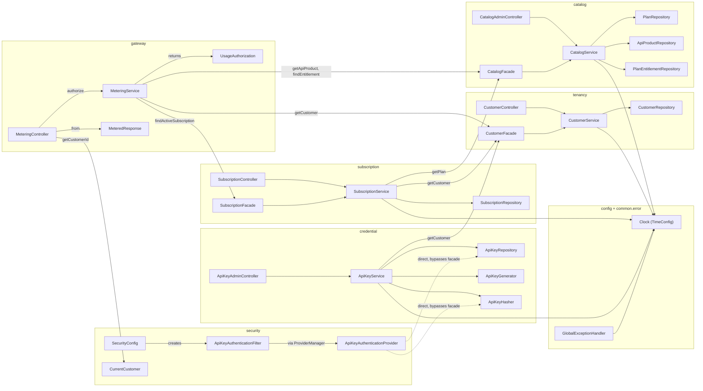
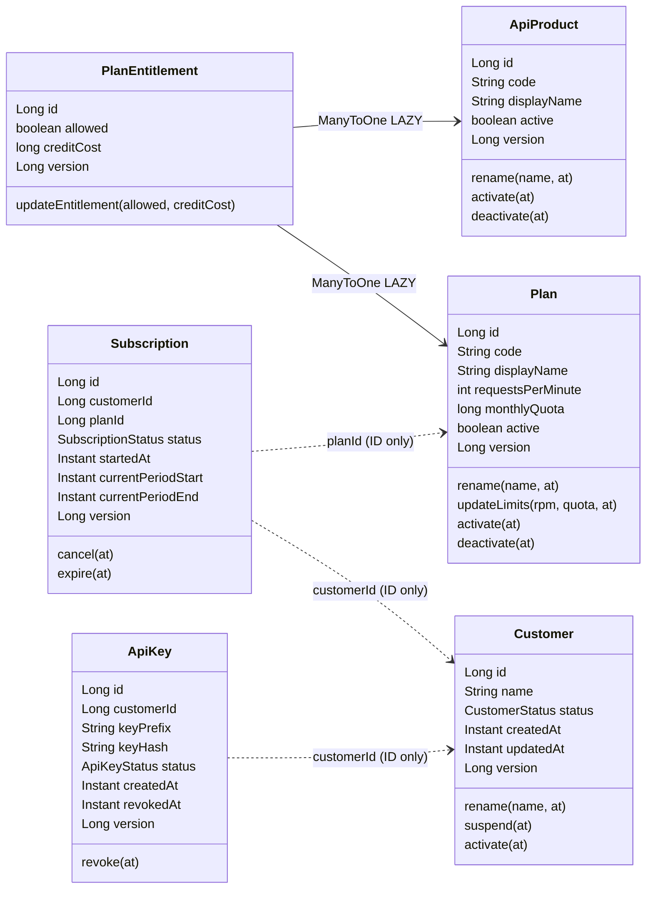

# Component Design

> Part of the [MeterFlow Technical Documentation](../README.md). The prerequisite is [System Overview](system-overview.md).

## Table of Contents

1. [Source Tree](#1-source-tree)
2. [Component Diagram](#2-component-diagram)
3. [Module Catalogue](#3-module-catalogue)
4. [Domain Model Class Diagram](#4-domain-model-class-diagram)
5. [Cross-Module Dependency Rules](#5-cross-module-dependency-rules)
6. [Entry Points](#6-entry-points)
7. [Test Components](#7-test-components)
8. [Dead or Placeholder Code](#8-dead-or-placeholder-code)

---

## 1. Source Tree

```
src/main/java/com/meterflow/
├── MeterFlowApplication.java          # @SpringBootApplication entry point
├── config/
│   └── TimeConfig.java                # @Bean Clock (UTC)
├── common/error/
│   ├── ErrorCode.java                 # enum: business error → HttpStatus
│   ├── MeterFlowException.java        # RuntimeException carrying an ErrorCode
│   └── GlobalExceptionHandler.java    # @RestControllerAdvice → ProblemDetail
├── tenancy/
│   ├── CustomerFacade.java            # public module API
│   ├── api/       CustomerController, CreateCustomerRequest, CustomerResponse, CustomerView
│   ├── domain/    Customer, CustomerStatus
│   ├── repository/CustomerRepository
│   └── service/   CustomerService
├── catalog/
│   ├── CatalogFacade.java             # public module API
│   ├── api/       CatalogAdminController, request/response records, PlanView, ApiProductView, EntitlementView
│   ├── domain/    ApiProduct, Plan, PlanEntitlement
│   ├── repository/ApiProductRepository, PlanRepository, PlanEntitlementRepository
│   └── service/   CatalogService
├── subscription/
│   ├── SubscriptionFacade.java        # public module API
│   ├── api/       SubscriptionController, CreateSubscriptionRequest, SubscriptionResponse, SubscriptionView
│   ├── domain/    Subscription, SubscriptionStatus
│   ├── repository/SubscriptionRepository
│   └── service/   SubscriptionService
├── credential/
│   ├── CredentialFacade.java          # EMPTY placeholder
│   ├── api/       ApiKeyAdminController, ApiKeyResponse, CreateApiKeyResponse, CreateApiKeyRequest (empty)
│   ├── domain/    ApiKey, ApiKeyStatus
│   ├── repository/ApiKeyRepository
│   └── service/   ApiKeyService, ApiKeyGenerator, ApiKeyHasher
├── security/
│   ├── SecurityConfig.java            # two SecurityFilterChains
│   ├── ApiKeyAuthenticationFilter.java
│   ├── ApiKeyAuthenticationProvider.java
│   ├── ApiKeyAuthenticationToken.java
│   └── CurrentCustomer.java           # reads customerId from SecurityContext
└── gateway/
    ├── api/       MeteringController, MeteredRequest, MeteredResponse
    └── service/   MeteringService, UsageAuthorization

src/main/resources/
├── application.yml, application-local.yml, application-test.yml
└── db/migration/V1__baseline.sql … V6__api_key.sql
```

## 2. Component Diagram

Source: [`../diagrams/component-diagram.mmd`](../diagrams/component-diagram.mmd)



**Explanation**

- **Solid arrows inside a module** show the normal layered call path: controller → service → repository.
- **Solid arrows between modules** always land on a *facade* (`CustomerFacade`, `CatalogFacade`, `SubscriptionFacade`). That is the intended module boundary. `MeteringService` is the only component that uses all three.
- **Dashed arrows** mark boundary violations. `ApiKeyAuthenticationProvider` (security) uses `credential`'s repository and hasher directly.
- `Clock` is a shared infrastructure bean. Every timestamp the application writes comes from `Instant.now(clock)`.

## 3. Module Catalogue

### 3.1 `tenancy`: customers

| Class | Stereotype | Responsibility |
|---|---|---|
| [`CustomerController`](../../src/main/java/com/meterflow/tenancy/api/CustomerController.java) | `@RestController` `/customers` | `create`, `getById`, `getAll` |
| [`CustomerService`](../../src/main/java/com/meterflow/tenancy/service/CustomerService.java) | `@Service` | `createCustomer(name)`, `getCustomer(id)` (throws `CUSTOMER_NOT_FOUND`), `getAll()` |
| [`CustomerFacade`](../../src/main/java/com/meterflow/tenancy/CustomerFacade.java) | `@Component` | Public API for other modules: `getCustomer(id) → CustomerView` |
| [`Customer`](../../src/main/java/com/meterflow/tenancy/domain/Customer.java) | `@Entity customer` | `name`, `status`, timestamps, `@Version`. Methods: `rename`, `suspend`, `activate` |
| `CustomerStatus` | enum | `ACTIVE`, `SUSPENDED` |
| `CustomerView` / `CustomerResponse` | records | `(id, name, status)` |
| `CustomerRepository` | `JpaRepository<Customer, Long>` | CRUD only |

### 3.2 `catalog`: products, plans, entitlements

| Class | Stereotype | Responsibility |
|---|---|---|
| [`CatalogAdminController`](../../src/main/java/com/meterflow/catalog/api/CatalogAdminController.java) | `@RestController` `/admin` | Product and plan CRUD, entitlement upsert |
| [`CatalogService`](../../src/main/java/com/meterflow/catalog/service/CatalogService.java) | `@Service` | All catalog business rules (see [Business Logic §2](../technical-design/business-logic.md#2-catalog)) |
| [`CatalogFacade`](../../src/main/java/com/meterflow/catalog/CatalogFacade.java) | `@Component` | `getPlan(code) → PlanView`, `getApiProduct(code) → ApiProductView` (404 if missing), `findEntitlement(planId, apiProductId) → Optional<EntitlementView>` |
| [`ApiProduct`](../../src/main/java/com/meterflow/catalog/domain/ApiProduct.java) | `@Entity api_product` | `code`, `displayName`, `active`. Methods: `rename`, `activate`, `deactivate` |
| [`Plan`](../../src/main/java/com/meterflow/catalog/domain/Plan.java) | `@Entity plan` | `code`, `displayName`, `requestsPerMinute`, `monthlyQuota`, `active`. Methods: `rename`, `updateLimits`, `activate`, `deactivate` |
| [`PlanEntitlement`](../../src/main/java/com/meterflow/catalog/domain/PlanEntitlement.java) | `@Entity plan_entitlement` | `@ManyToOne(LAZY)` to `Plan` and `ApiProduct`, `allowed`, `creditCost`. Method: `updateEntitlement` |
| `ApiProductRepository` | Spring Data | `findByCode`, `existsByCode`, `findAll(Pageable)` |
| `PlanRepository` | Spring Data | `findByCode`, `existsByCode` |
| `PlanEntitlementRepository` | Spring Data | `findByPlanCodeAndApiProductCode` (implicit join, used by the admin upsert), `findByPlanIdAndApiProductId` (FK columns only, used by the data plane) |
| Records | DTOs | `CreateApiProductRequest`, `UpdateApiProductRequest`, `ApiProductResponse`, `CreatePlanRequest`, `UpdatePlanRequest`, `PlanResponse`, `PlanView`, `UpsertPlanEntitlementRequest`, `PlanEntitlementResponse`. Cross-module views: `ApiProductView(id, code, active)`, `EntitlementView(id, allowed, creditCost)` |

### 3.3 `subscription`

| Class | Stereotype | Responsibility |
|---|---|---|
| [`SubscriptionController`](../../src/main/java/com/meterflow/subscription/api/SubscriptionController.java) | `@RestController` `/customers/{customerId}/subscriptions` | `subscribe`, `getActiveSubscription`, `cancelActiveSubscription` |
| [`SubscriptionFacade`](../../src/main/java/com/meterflow/subscription/SubscriptionFacade.java) | `@Component` | Public API for other modules: `findActiveSubscription(customerId) → Optional<SubscriptionView>` |
| [`SubscriptionService`](../../src/main/java/com/meterflow/subscription/service/SubscriptionService.java) | `@Service` | Subscription rules and DB-constraint translation |
| `SubscriptionView` | record | `(id, customerId, planId, currentPeriodStart, currentPeriodEnd)` |
| [`Subscription`](../../src/main/java/com/meterflow/subscription/domain/Subscription.java) | `@Entity subscription` | `customerId`, `planId` (IDs only), `status`, period fields. Methods: `cancel`, `expire` |
| `SubscriptionStatus` | enum | `ACTIVE`, `CANCELLED`, `EXPIRED` |
| `SubscriptionRepository` | Spring Data | `findByCustomerIdAndStatus` |

### 3.4 `credential`: API keys

| Class | Stereotype | Responsibility |
|---|---|---|
| [`ApiKeyAdminController`](../../src/main/java/com/meterflow/credential/api/ApiKeyAdminController.java) | `@RestController` `/admin/customers/{customerId}/api-keys` | `createApiKey`, `listApiKeys`, `revokeApiKey` |
| [`ApiKeyService`](../../src/main/java/com/meterflow/credential/service/ApiKeyService.java) | `@Service` | Issue, list and revoke, with an ownership check |
| [`ApiKeyGenerator`](../../src/main/java/com/meterflow/credential/service/ApiKeyGenerator.java) | `@Component` | `generate()` → `mf_live_` + 32 random bytes, base64url without padding. `extractPrefix()` → first 16 chars |
| [`ApiKeyHasher`](../../src/main/java/com/meterflow/credential/service/ApiKeyHasher.java) | `@Component` | `hash(raw)` → SHA-256 as lower-case hex |
| [`ApiKey`](../../src/main/java/com/meterflow/credential/domain/ApiKey.java) | `@Entity api_key`, Lombok `@Getter` | `customerId`, `keyPrefix`, `keyHash`, `status`, `revokedAt`. Method: `revoke` |
| `ApiKeyStatus` | enum | `ACTIVE`, `REVOKED` |
| `ApiKeyRepository` | Spring Data | `findByKeyHash`, `findByCustomerId`, `findByCustomerIdAndStatus` (unused) |
| `CreateApiKeyResponse` | record | `(id, apiKey, prefix, createdAt)`: the **only** place where the raw key appears |
| `ApiKeyResponse` | record | `(id, prefix, status, createdAt, revokedAt)` |

### 3.5 `security`

| Class | Stereotype | Responsibility |
|---|---|---|
| [`SecurityConfig`](../../src/main/java/com/meterflow/security/SecurityConfig.java) | `@Configuration` | `apiSecurityFilterChain` (`@Order(1)`, `/v1/**`) and `temporaryAdminSecurityFilterChain` (`@Order(2)`) |
| [`ApiKeyAuthenticationFilter`](../../src/main/java/com/meterflow/security/ApiKeyAuthenticationFilter.java) | `OncePerRequestFilter` (**not** a bean) | Reads `X-API-Key`, authenticates, sets and clears the `SecurityContext` |
| [`ApiKeyAuthenticationProvider`](../../src/main/java/com/meterflow/security/ApiKeyAuthenticationProvider.java) | `@Component AuthenticationProvider` | Hash → lookup → `ACTIVE` check → authenticated token |
| [`ApiKeyAuthenticationToken`](../../src/main/java/com/meterflow/security/ApiKeyAuthenticationToken.java) | `AbstractAuthenticationToken` | Principal = `customerId`, credentials = raw key (erased after authentication), authority `ROLE_API_CLIENT` |
| [`CurrentCustomer`](../../src/main/java/com/meterflow/security/CurrentCustomer.java) | `@Component` | `getCustomerId()` reads the principal or throws `IllegalStateException` |

### 3.6 `gateway`: data plane

| Class | Stereotype | Responsibility |
|---|---|---|
| [`MeteringController`](../../src/main/java/com/meterflow/gateway/api/MeteringController.java) | `@RestController` `/v1` | `POST /usage`: takes the customer from `CurrentCustomer`, never from the body. Calls `authorize` and maps the result with `MeteredResponse.from` |
| [`MeteringService`](../../src/main/java/com/meterflow/gateway/service/MeteringService.java) | `@Service` | `authorize(customerId, productCode)`, `@Transactional(readOnly = true)`: customer `ACTIVE` → product exists and active → `ACTIVE` subscription → allowed entitlement → credit cost. Uses `CustomerFacade`, `CatalogFacade`, `SubscriptionFacade`. See [Business Logic § 5](../technical-design/business-logic.md#5-metering-gateway--m3) |
| [`UsageAuthorization`](../../src/main/java/com/meterflow/gateway/service/UsageAuthorization.java) | record | Internal result: `(customerId, subscriptionId, planId, apiProductId, productCode, creditCost)`. Input for the M4 wallet debit |
| `MeteredRequest` | record | `productCode` (`@NotBlank`) |
| [`MeteredResponse`](../../src/main/java/com/meterflow/gateway/api/MeteredResponse.java) | record | Public response: `(customerId, productCode, subscriptionId, planId, creditCost)`. Omits `apiProductId` |

### 3.7 `common.error` and `config`

| Class | Responsibility |
|---|---|
| [`ErrorCode`](../../src/main/java/com/meterflow/common/error/ErrorCode.java) | Maps each business error to an `HttpStatus` (full list in [API Reference § Errors](../api/api-reference.md#3-error-model)) |
| [`MeterFlowException`](../../src/main/java/com/meterflow/common/error/MeterFlowException.java) | Unchecked exception carrying an `ErrorCode` |
| [`GlobalExceptionHandler`](../../src/main/java/com/meterflow/common/error/GlobalExceptionHandler.java) | Converts exceptions into `ProblemDetail` with `errorCode` and `timestamp` |
| [`TimeConfig`](../../src/main/java/com/meterflow/config/TimeConfig.java) | `Clock.systemUTC()` bean |

## 4. Domain Model Class Diagram



**Explanation:** Solid arrows are real JPA associations, and they exist only inside the `catalog` module. Dashed arrows are references **by identifier** across module boundaries, so no JPA navigation or lazy loading crosses modules.

## 5. Cross-Module Dependency Rules

These are the intended rules, inferred from the code structure:

1. A module may depend on another module **only through its facade** (`tenancy.CustomerFacade`, `catalog.CatalogFacade`, `subscription.SubscriptionFacade`).
2. Facades return **view records** (`CustomerView`, `PlanView`, `ApiProductView`, `EntitlementView`, `SubscriptionView`), never entities or HTTP DTOs. Where "not found" is the caller's decision, they return `Optional`.
3. Entities in different modules reference each other by `Long` ID only.
4. Every module may depend on `common.error` and `config`.

**Current violations:**

| Violation | Location |
|---|---|
| `security` → `credential.repository.ApiKeyRepository`, `credential.service.ApiKeyHasher` | `ApiKeyAuthenticationProvider` |
| `subscription` → `tenancy.domain.CustomerStatus` | `SubscriptionService.subscribe` |
| `gateway` → `tenancy.domain.CustomerStatus` | `MeteringService.authorize`. Same root cause: `CustomerView.status` exposes the domain enum |
| `CustomerController.getAll` returns `List<Customer>` (an entity) | `CustomerController` |

## 6. Entry Points

| Entry point | Kind |
|---|---|
| [`MeterFlowApplication.main`](../../src/main/java/com/meterflow/MeterFlowApplication.java) | JVM bootstrap |
| 18 HTTP endpoints | See [API Reference](../api/api-reference.md) |
| Actuator `/actuator/health`, `/actuator/info` | Operations |
| Flyway migrations | Run automatically at startup, before the JPA `EntityManagerFactory` validates the schema |

There are no CLI runners (`CommandLineRunner`), schedulers, message listeners or `@EventListener`s.

## 7. Test Components

| Test | Covers |
|---|---|
| [`IntegrationTest`](../../src/test/java/com/meterflow/support/IntegrationTest.java) | Base class: full context, MockMvc, `test` profile |
| `CatalogAdminControllerIntegrationTest` | Product endpoints, pagination, validation |
| `PlanAdminControllerIntegrationTest` | Plan CRUD, entitlement upsert |
| `PlanEntitlementIntegrationTest` | Empty placeholder (3 lines) |
| `ApiKeyAdminControllerIntegrationTest` | Key issue, list and revoke, ownership |
| `SubscriptionControllerIntegrationTest` | Subscribe, active, cancel, error cases |
| [`SubscriptionConcurrencyIntegrationTest`](../../src/test/java/com/meterflow/subscription/SubscriptionConcurrencyIntegrationTest.java) | Two concurrent `subscribe` calls: exactly one succeeds and one gets `SUBSCRIPTION_ALREADY_ACTIVE` |
| [`ApiKeySecurityIntegrationTest`](../../src/test/java/com/meterflow/security/ApiKeySecurityIntegrationTest.java) | 401 when the key is missing, invalid or revoked. Success with an active key. No context leak between requests |
| [`MeteringControllerIntegrationTest`](../../src/test/java/com/meterflow/gateway/MeteringControllerIntegrationTest.java) | 11 tests: success with full response and credit cost, code normalization, suspended customer (403), unknown product (404), inactive product (403), no subscription and cancelled subscription (403), missing and disallowed entitlement (403), deactivated plan still allowed (200), missing key (401) |
| `GlobalExceptionHandlerIntegrationTest` | **Empty.** It has no test methods. The error shape is covered indirectly by `$.errorCode` assertions in the other tests |
| `DataPlaneTestController`, `AdminSecurityTestController` | Test-only controllers exposing `GET /v1/ping` (returns `{"customerId": ...}`) and `GET /admin/ping` (returns `"admin"`). They are **not** part of the production build |

## 8. Dead or Placeholder Code

| Item | Status |
|---|---|
| `credential.CredentialFacade` | Empty class, not a bean |
| `credential.api.CreateApiKeyRequest` | Empty class, unused (the create endpoint takes no body) |
| `ErrorCode.CONCURRENT_MODIFICATION` | Defined but never thrown or mapped |
| `ApiKeyRepository.findByCustomerIdAndStatus` | Unused |
| `Customer.rename/suspend/activate`, `Subscription.expire`, `ApiProduct.rename` | Domain methods with no caller |
| `idx_api_key_prefix` index | No query uses `key_prefix` |
| Kotlin dependencies and plugin | No Kotlin sources |
