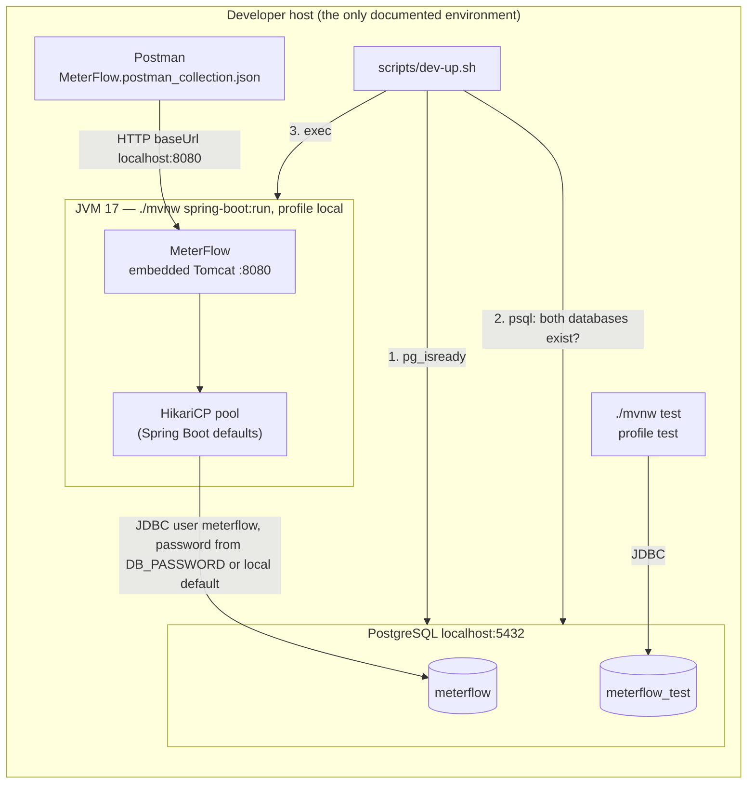
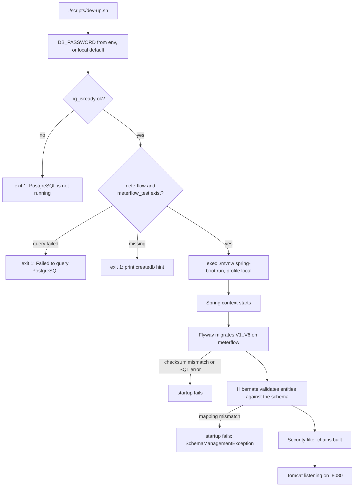

# Deployment Architecture

> Part of the [MeterFlow Technical Documentation](../README.md).

## Table of Contents

1. [Current State](#1-current-state)
2. [Deployment Diagram](#2-deployment-diagram)
3. [Infrastructure Components](#3-infrastructure-components)
4. [Environment Configuration](#4-environment-configuration)
5. [Startup Procedure](#5-startup-procedure)
6. [Build and Packaging](#6-build-and-packaging)
7. [Operational Endpoints](#7-operational-endpoints)
8. [Production Readiness Gaps](#8-production-readiness-gaps)

---

## 1. Current State

The repository contains **no production deployment assets**:

| Asset | Present? |
|---|---|
| `Dockerfile` / OCI image configuration | ❌ No. `spring-boot-maven-plugin` could build an image with `./mvnw spring-boot:build-image`, but this has not been configured or verified **[Unverified]** |
| `docker-compose.yml` | ❌ No |
| Kubernetes / Helm / Terraform | ❌ No |
| CI/CD pipeline (GitHub Actions, etc.) | ❌ No |
| Production Spring profile | ❌ No. Only `local` and `test` exist |
| Local developer script | ✅ [`scripts/dev-up.sh`](../../scripts/dev-up.sh) |

The only documented topology is therefore **a developer workstation with a local PostgreSQL**.

## 2. Deployment Diagram

Source: [`../diagrams/deployment-diagram.mmd`](../diagrams/deployment-diagram.mmd)



**Explanation**

- `dev-up.sh` resolves `DB_PASSWORD` (environment or local default), then runs two checks in order, and any failure stops it with a clear message. After the checks it `exec`s Maven, so the Maven process replaces the shell.
- The running application talks only to `meterflow`. The test suite talks only to `meterflow_test`. The two never share data.
- Connection pooling is HikariCP, Spring Boot's default. No pool size is configured, so the defaults apply. **[Unverified]** The default maximum pool size is 10.
- Port `8080` is Spring Boot's default. `server.port` is not set anywhere.

## 3. Infrastructure Components

| Component | Role | Required version | Configured in |
|---|---|---|---|
| JDK | Runtime | 17 | `pom.xml` (`java.version`, `release`), `dev-up.sh` (`JAVA_HOME`) |
| PostgreSQL | Only datastore | Not pinned. Needs partial indexes and `TIMESTAMPTZ` (any modern version) **[Unverified exact minimum]** | `application-local.yml`, `application-test.yml` |
| `pg_isready`, `psql` | Readiness check in the script | — | `dev-up.sh` |
| Maven Wrapper | Build and run | `.mvn/wrapper` | `mvnw` |

## 4. Environment Configuration

### 4.1 Configuration files

| File | Active when | Contents |
|---|---|---|
| [`application.yml`](../../src/main/resources/application.yml) | Always | `spring.application.name`, `jpa.hibernate.ddl-auto: validate`, `jpa.open-in-view: false`, `flyway.enabled: true`, Actuator exposure `health,info` |
| [`application-local.yml`](../../src/main/resources/application-local.yml) | Profile `local` | Datasource `jdbc:postgresql://localhost:5432/meterflow`, user `meterflow`, password `${DB_PASSWORD:<local default>}`, `jpa.show-sql: true` |
| [`application-test.yml`](../../src/main/resources/application-test.yml) | Profile `test` | Datasource `.../meterflow_test`, user `meterflow`, password `${DB_PASSWORD:<local default>}`, `show-sql: false`, `flyway.clean-disabled: true`, `ddl-auto: validate` |
| `application-prod.yml` | — | **Does not exist.** See § 4.3 |

The base `application.yml` contains **no datasource settings and no password default**. Only the `local` and `test` profile files define a fallback password, for developer convenience. The literal value is intentionally not repeated in this documentation.

### 4.2 Environment variables

| Variable | Used by | Required | Default |
|---|---|---|---|
| `DB_PASSWORD` | `local` and `test` profiles (`${DB_PASSWORD:<local default>}`), and `dev-up.sh`, which exports it as `PGPASSWORD` | No (local/test only) | The local-development default from the profile file. When set, the environment variable takes precedence (verified: a wrong `DB_PASSWORD` makes the `test` profile fail with `password authentication failed`) |
| `METERFLOW_JAVA_HOME` | `dev-up.sh` (exported as `JAVA_HOME`) | No | `/usr/lib/jvm/java-17-openjdk-amd64` |
| `POSTGRES_HOST`, `POSTGRES_PORT` | `dev-up.sh` readiness check **only** | No | `localhost`, `5432` |
| `DB_USER` | `dev-up.sh` `psql` check **only** | No | `meterflow` |

> ⚠️ `POSTGRES_HOST`, `POSTGRES_PORT` and `DB_USER` affect **only the script's checks**. The application's JDBC URL and username are hard-coded in the profile YAML files. To point the application at another host, override `SPRING_DATASOURCE_URL` and `SPRING_DATASOURCE_USERNAME`, which Spring Boot's relaxed binding supports.

### 4.3 Production credentials

There is no production profile in the repository, so there is nothing in it that could fall back to a default password. Behaviour verified on 2026-11-07 by starting the application with `DB_PASSWORD` unset:

| Startup | Result |
|---|---|
| No profile | Fails: `Failed to determine a suitable driver class` (no datasource URL) |
| `SPRING_PROFILES_ACTIVE=prod` (profile file absent) | Fails the same way |
| `prod` + `SPRING_DATASOURCE_URL` and `SPRING_DATASOURCE_USERNAME`, no password | Fails: Flyway cannot connect, `The server requested SCRAM-based authentication, but no password was provided` |

Rules for a production deployment:

- Supply the datasource entirely from the environment or a secret store (`SPRING_DATASOURCE_URL`, `SPRING_DATASOURCE_USERNAME`, `SPRING_DATASOURCE_PASSWORD`, or an equivalent secret mechanism).
- **Never activate the `local` or `test` profile in production.** Both files are packaged in the JAR and both contain the local fallback password.
- The last failure in the table relies on PostgreSQL requiring password authentication. If a future `application-prod.yml` is added, reference the password **without a default** (for example `${DB_PASSWORD}`), so that a missing variable fails startup inside the application regardless of the server's authentication settings.

## 5. Startup Procedure



**Explanation:** Startup is fail-fast at every layer. The shell checks run first, then Flyway (schema evolution), then Hibernate `validate`, which guarantees that entities and tables agree. Because `ddl-auto` is `validate`, Hibernate never changes the schema.

## 6. Build and Packaging

```bash
./mvnw clean package          # runs tests; needs meterflow_test (DB_PASSWORD optional, see § 4.2)
./mvnw clean package -DskipTests
java -jar target/meterflow-0.0.1-SNAPSHOT.jar --spring.profiles.active=local
```

Build notes, taken from [`pom.xml`](../../pom.xml):

- `kotlin-maven-plugin` runs in the `compile` and `test-compile` phases. The default `maven-compiler-plugin` executions are disabled (`<phase>none</phase>`) and re-declared, so that Java compiles after Kotlin. Since there are no Kotlin sources, this setup has no functional purpose.
- Lombok is wired as an annotation processor for `maven-compiler-plugin`, and also as a Kotlin compiler plugin.

## 7. Operational Endpoints

| Endpoint | Exposure | Auth |
|---|---|---|
| `GET /actuator/health` | Exposed | None (chain 2, `permitAll`) |
| `GET /actuator/info` | Exposed | None |
| Other Actuator endpoints | Not exposed over HTTP | — |

## 8. Production Readiness Gaps

| Gap | Recommendation |
|---|---|
| No container image or orchestration manifests | Add a `Dockerfile` (or `spring-boot:build-image`) and compose/K8s manifests |
| No production profile | Add `application-prod.yml`, with the datasource from environment variables **without defaults**, `show-sql: false` and pool tuning. See § 4.3 |
| No CI | Add a pipeline running `./mvnw verify` with a PostgreSQL service container |
| Tests depend on a locally provisioned database | Consider Testcontainers |
| Control plane unauthenticated | **[Roadmap]** M10. Until then, do not expose the service publicly |
| No metrics or tracing | Add Micrometer and Prometheus, plus a request correlation ID in the MDC |
| Stateless app (scales horizontally today) | Future in-memory rate limiting or caching must account for multiple instances. See [Performance](../technical-design/performance.md) |
