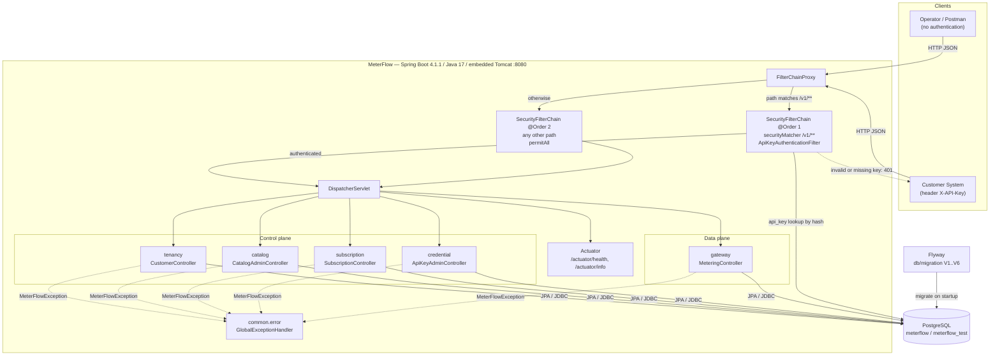

# System Overview

> Part of the [MeterFlow Technical Documentation](../README.md).

## Table of Contents

1. [Business Context](#1-business-context)
2. [Actors and Roles](#2-actors-and-roles)
3. [High-Level Architecture](#3-high-level-architecture)
4. [Architectural Patterns](#4-architectural-patterns)
5. [Technology Stack](#5-technology-stack)
6. [Integrations](#6-integrations)
7. [Key Architectural Decisions](#7-key-architectural-decisions)
8. [Known Architectural Limitations](#8-known-architectural-limitations)

---

## 1. Business Context

A company that sells API access, for example an SMS or OCR API, needs to answer four questions for every incoming call:

1. **Who is calling?** → API-key authentication.
2. **Are they allowed to call this product?** → subscription plus plan entitlement.
3. **How much does the call cost?** → the entitlement's `creditCost`.
4. **Are they within their limits?** → plan `requestsPerMinute` and `monthlyQuota`.

MeterFlow models the commercial catalog (products, plans, entitlements), the customer lifecycle (customers, subscriptions, API keys) and the data-plane entry point (`POST /v1/usage`) that answers those questions.

**Current coverage:**

| Question | Status in code |
|---|---|
| 1. Who is calling? | ✅ Implemented: [`ApiKeyAuthenticationProvider`](../../src/main/java/com/meterflow/security/ApiKeyAuthenticationProvider.java) |
| 2. Are they allowed? | ✅ Implemented (M3): customer `ACTIVE`, product exists and active, `ACTIVE` subscription, allowed entitlement, in [`MeteringService`](../../src/main/java/com/meterflow/gateway/service/MeteringService.java). Billing-period expiry is not checked yet (**[Roadmap]** M5) |
| 3. How much does it cost? | ✅ Resolved (M3): `plan_entitlement.credit_cost` is returned as `creditCost`. ❌ Not charged yet: no wallet debit or usage record (**[Roadmap]** M4) |
| 4. Within limits? | ❌ Not yet. Data is modelled in `plan` but not enforced (**[Roadmap]** M5 quota, M7–M9 rate limit) |

## 2. Actors and Roles

| Actor | Interface | Authentication | Granted authority |
|---|---|---|---|
| **Operator / Admin** | `/admin/**`, `/customers/**` | **None.** `temporaryAdminSecurityFilterChain` is `permitAll` (**[Roadmap]** M10 introduces admin identity) | — |
| **Customer system (API client)** | `/v1/**` | `X-API-Key` header | `ROLE_API_CLIENT`, principal = `customerId` |
| **Monitoring** | `/actuator/health`, `/actuator/info` | None | — |

## 3. High-Level Architecture

Source: [`../diagrams/system-architecture.mmd`](../diagrams/system-architecture.mmd)

**How to read this diagram**

- Every HTTP request enters through Spring Security's `FilterChainProxy`. It picks **exactly one** chain: chain 1 if the path matches `/v1/**`, otherwise chain 2.
- Chain 1 authenticates with the API key **before** the request reaches any controller. A missing, unknown or revoked key ends in `401` and never reaches `DispatcherServlet`.
- Chain 2 lets everything through. That covers the whole control plane, plus `/error` and `/actuator/**`.
- All business modules share **one** PostgreSQL database. The schema is owned only by Flyway.
- Business errors are thrown as `MeterFlowException` and turned into RFC 7807 responses by `GlobalExceptionHandler`. Security errors (401) are **not** handled there, because they happen in the filter layer. See [Application Flow § Error Handling](../technical-design/application-flow.md#6-exception-handling).

## 4. Architectural Patterns

| Pattern | Where it is applied | Evidence |
|---|---|---|
| **Modular monolith** | One deployable, with packages per bounded context | `com.meterflow.{tenancy,catalog,subscription,credential,security,gateway}` |
| **Package by feature + layered inside** | Each module has `api` / `service` / `domain` / `repository` | e.g. `catalog/api/CatalogAdminController`, `catalog/service/CatalogService` |
| **Facade (module public API)** | Cross-module calls go through a facade and return read-only views | [`CustomerFacade`](../../src/main/java/com/meterflow/tenancy/CustomerFacade.java) → `CustomerView`; [`CatalogFacade`](../../src/main/java/com/meterflow/catalog/CatalogFacade.java) → `PlanView` |
| **Reference by identity across modules** | `Subscription.customerId`, `Subscription.planId` and `ApiKey.customerId` are plain `Long`s, not `@ManyToOne` | [`Subscription`](../../src/main/java/com/meterflow/subscription/domain/Subscription.java), [`ApiKey`](../../src/main/java/com/meterflow/credential/domain/ApiKey.java) |
| **Rich domain model** | State changes go through intention-revealing methods (`activate`, `deactivate`, `rename`, `updateLimits`, `cancel`, `revoke`). There are no public setters | [`Plan`](../../src/main/java/com/meterflow/catalog/domain/Plan.java), [`ApiKey`](../../src/main/java/com/meterflow/credential/domain/ApiKey.java) |
| **Repository** | Spring Data JPA derived queries | `*Repository` interfaces |
| **DTO / Record mapping** | Immutable Java records for requests, responses and views, with static `from(entity)` factories | `PlanResponse.from`, `ApiKeyResponse.from` |
| **Database as an invariant guard** | CHECK, UNIQUE and partial UNIQUE constraints back up the business rules | [`V5__subscription.sql`](../../src/main/resources/db/migration/V5__subscription.sql) |
| **Optimistic locking** | `@Version` on every entity | All `domain` classes |
| **Chain of Responsibility / Strategy** | Servlet filter chain, `ProviderManager` → `AuthenticationProvider` | [`SecurityConfig`](../../src/main/java/com/meterflow/security/SecurityConfig.java) |
| **Template Method** | `OncePerRequestFilter.doFilterInternal`, `ResponseEntityExceptionHandler` overrides | [`ApiKeyAuthenticationFilter`](../../src/main/java/com/meterflow/security/ApiKeyAuthenticationFilter.java), [`GlobalExceptionHandler`](../../src/main/java/com/meterflow/common/error/GlobalExceptionHandler.java) |
| **Injectable time source** | A `Clock` bean is used by all services | [`TimeConfig`](../../src/main/java/com/meterflow/config/TimeConfig.java) |

## 5. Technology Stack

| Technology | What it is | Why it is used here | Key configuration |
|---|---|---|---|
| **Spring Boot 4.1.1** | Opinionated framework and auto-configuration | Wires MVC, Security, JPA, Flyway and Actuator | `pom.xml` parent `spring-boot-starter-parent:4.1.1` |
| **Spring Web MVC** | Servlet-based web framework on embedded Tomcat | Synchronous REST API with thread-per-request | `spring-boot-starter-webmvc` |
| **Spring Security** | Filter-based security framework | Separates the data plane (API key) from the control plane | Two `SecurityFilterChain` beans with `@Order(1)` and `@Order(2)` |
| **Spring Data JPA + Hibernate** | ORM and repository abstraction | Entity persistence, dirty checking, optimistic locking | `ddl-auto: validate`, `open-in-view: false` |
| **PostgreSQL** | Relational database | Strong constraints, partial unique indexes, `TIMESTAMPTZ` | JDBC URL in `application-local.yml` / `application-test.yml` |
| **Flyway** | Schema migration tool | Single source of truth for the schema | `spring.flyway.enabled: true`. Test profile: `clean-disabled: true` |
| **Jakarta Bean Validation** | Declarative constraints | Request-body and parameter validation | `spring-boot-starter-validation` |
| **Actuator** | Operational endpoints | Liveness/health checks | `management.endpoints.web.exposure.include: health,info` |
| **Lombok** | Annotation processor | Small amount of boilerplate removal | Annotation processor configured in `maven-compiler-plugin` |
| **Kotlin (unused)** | — | No Kotlin sources exist. The plugin also reorders Java compilation (`default-compile` phase `none`) | `kotlin-maven-plugin` with `jvmTarget 1.8`. A cleanup candidate |

## 6. Integrations

| System | Type | Direction | Notes |
|---|---|---|---|
| PostgreSQL | Database | MeterFlow → DB (JDBC) | The only runtime dependency |
| Postman | Developer tool | Client → MeterFlow | [`postman/`](../../postman/) |

**There are no** message brokers, caches, external HTTP APIs, payment providers, identity providers, email/SMS providers or schedulers in the current code. **[Roadmap]** Kafka and a transactional outbox are listed for M7–M9 (provisional).

## 7. Key Architectural Decisions

| # | Decision | Rationale | Source |
|---|---|---|---|
| AD-1 | Modular monolith, no premature microservices | Simplicity and transactional consistency | Code structure + **[Roadmap]** |
| AD-2 | Database constraints are part of business correctness | Correct under concurrency without application locks | `V3`–`V6` migrations, `SubscriptionService.isActiveSubscriptionUniqueViolation` |
| AD-3 | Store only a SHA-256 hash of API keys | A DB leak does not expose usable keys, and a deterministic hash allows indexed lookup | [`ApiKeyHasher`](../../src/main/java/com/meterflow/credential/service/ApiKeyHasher.java) |
| AD-4 | Stateless data-plane authentication | Horizontal scalability, no session store | `SessionCreationPolicy.STATELESS` |
| AD-5 | Business codes normalized to upper case | Case-insensitive identifiers without SQL `lower()` | `trim().toUpperCase(Locale.ROOT)` in `CatalogService` |
| AD-6 | RFC 7807 `ProblemDetail` with a stable `errorCode` | Machine-readable, consistent error contract | [`GlobalExceptionHandler`](../../src/main/java/com/meterflow/common/error/GlobalExceptionHandler.java) |
| AD-7 | Credits as `BIGINT` milli-credits, never float/double | Exact financial arithmetic | `plan_entitlement.credit_cost BIGINT`, `long creditCost` through `EntitlementView`, `UsageAuthorization` and `MeteredResponse`. The milli-credit unit is a project convention; the code does not encode it |
| AD-8 | Wallet debits will be atomic, not optimistic-locked | Throughput and correctness under contention | **[Roadmap]** M4, not implemented |
| AD-9 | Billing period is per customer, not the calendar month | Fair period boundaries | `subscription.current_period_start/end` + **[Roadmap]** M5 |

## 8. Known Architectural Limitations

| Limitation | Impact | Planned resolution |
|---|---|---|
| Control plane is unauthenticated | Anyone who can reach the service can create customers and issue keys | **[Roadmap]** M10 |
| `security` reads `credential` internals directly (`ApiKeyRepository`, `ApiKeyHasher`) | Breaks the facade boundary. [`CredentialFacade`](../../src/main/java/com/meterflow/credential/CredentialFacade.java) exists but is empty | Not scheduled |
| `CustomerView` exposes `tenancy.domain.CustomerStatus` | `subscription` and `gateway` import a `tenancy` domain enum | Not scheduled |
| `SubscriptionService` imports `tenancy.domain.CustomerStatus` | Minor cross-module domain coupling | Not scheduled |
| `CustomerController.getAll` returns the JPA entity `Customer` | Leaks persistence fields (`version`, timestamps) | Not scheduled |
| No background processing | `Subscription.expire()` and `Customer.suspend()` exist but are never called | **[Roadmap]** M5 billing periods |

See [Component Design](component-design.md) for module-level detail.
