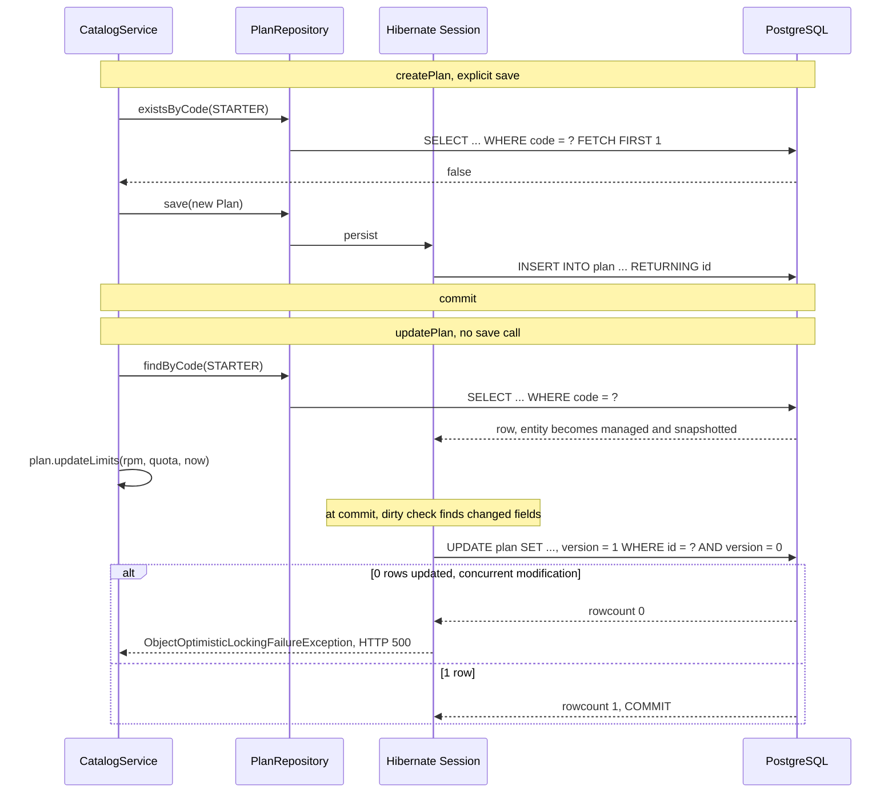
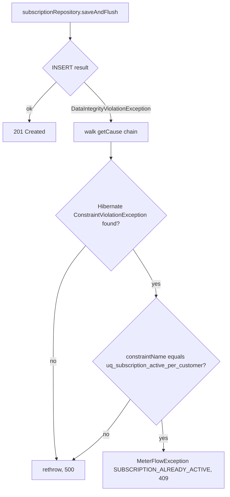

# Database Design

> Part of the [MeterFlow Technical Documentation](../README.md). The ER diagram is in [er-diagram.md](er-diagram.md).

## Table of Contents

1. [Overview](#1-overview)
2. [Schema Management with Flyway](#2-schema-management-with-flyway)
3. [Tables](#3-tables)
4. [Indexes](#4-indexes)
5. [Constraints Catalogue](#5-constraints-catalogue)
6. [Sequences and ID Generation](#6-sequences-and-id-generation)
7. [JPA Mapping](#7-jpa-mapping)
8. [Repository Queries](#8-repository-queries)
9. [Database Interaction Flows](#9-database-interaction-flows)
10. [Known Issues and Recommendations](#10-known-issues-and-recommendations)

---

## 1. Overview

| Property | Value |
|---|---|
| Engine | PostgreSQL |
| Databases | `meterflow` (profile `local`), `meterflow_test` (profile `test`) |
| Schema | Default (`public`) **[Unverified: no schema is configured explicitly]** |
| Owner of DDL | Flyway only. Hibernate runs with `ddl-auto: validate` |
| Tables | `customer`, `api_product`, `plan`, `plan_entitlement`, `subscription`, `api_key` (+ Flyway's `flyway_schema_history`) |
| Timestamps | `TIMESTAMPTZ` (`TIMESTAMP WITH TIME ZONE`), mapped to `java.time.Instant` |
| Enum storage | `TEXT` + `CHECK (status IN (...))`, mapped with `@Enumerated(EnumType.STRING)` |
| Concurrency column | `version BIGINT NOT NULL DEFAULT 0` on every table, mapped with `@Version` |

## 2. Schema Management with Flyway

Location: [`src/main/resources/db/migration/`](../../src/main/resources/db/migration/)

| Version | File | Changes |
|---|---|---|
| V1 | [`V1__baseline.sql`](../../src/main/resources/db/migration/V1__baseline.sql) | `CREATE TABLE customer (id BIGSERIAL PK, name VARCHAR(255), email VARCHAR(255) UNIQUE, created_at TIMESTAMPTZ)` |
| V2 | [`V2__baseline.sql`](../../src/main/resources/db/migration/V2__baseline.sql) | `customer.name` and `customer.email` → `TEXT` |
| V3 | [`V3__customer_constraints.sql`](../../src/main/resources/db/migration/V3__customer_constraints.sql) | Adds `status` (default `ACTIVE`, CHECK), `updated_at`, `version`, a non-blank name CHECK. **Drops `email`** |
| V4 | [`V4__catalog.sql`](../../src/main/resources/db/migration/V4__catalog.sql) | `api_product`, `plan`, `plan_entitlement` |
| V5 | [`V5__subscription.sql`](../../src/main/resources/db/migration/V5__subscription.sql) | `subscription`, partial unique index, composite index |
| V6 | [`V6__api_key.sql`](../../src/main/resources/db/migration/V6__api_key.sql) | `api_key` + two indexes |

Rules for contributors:

- **Never edit an applied migration.** Flyway validates checksums, and a changed file blocks startup.
- Add a new `V7__<description>.sql` for every schema change, then update the entity. `ddl-auto: validate` fails startup if the two disagree.
- `V2__baseline.sql` reuses the "baseline" description although it is a type change. Use descriptive names for new migrations.

## 3. Tables

### 3.1 `customer`

The tenant that owns subscriptions and API keys. Entity: [`Customer`](../../src/main/java/com/meterflow/tenancy/domain/Customer.java).

| Column | Type | Null | Default | Constraints / Notes |
|---|---|---|---|---|
| `id` | `BIGSERIAL` | NO | sequence | **PK** |
| `name` | `TEXT` | NO | — | `chk_customer_name_not_blank`: `length(trim(name)) > 0` |
| `created_at` | `TIMESTAMPTZ` | NO | — | Set by the application. The entity's `@Column` omits `nullable=false`, but the DB enforces it |
| `status` | `TEXT` | NO | `'ACTIVE'` | `chk_customer_status`: `IN ('ACTIVE','SUSPENDED')` |
| `updated_at` | `TIMESTAMPTZ` | NO | `CURRENT_TIMESTAMP` | |
| `version` | `BIGINT` | NO | `0` | Optimistic lock |

### 3.2 `api_product`

A sellable API. Entity: [`ApiProduct`](../../src/main/java/com/meterflow/catalog/domain/ApiProduct.java).

| Column | Type | Null | Default | Constraints / Notes |
|---|---|---|---|---|
| `id` | `BIGSERIAL` | NO | sequence | **PK** |
| `code` | `TEXT` | NO | — | **UNIQUE**. `chk_api_product_code_not_blank`. Stored upper-case by the app |
| `display_name` | `TEXT` | NO | — | `chk_api_product_display_name_not_blank` |
| `active` | `BOOLEAN` | NO | `TRUE` | |
| `created_at` | `TIMESTAMPTZ` | NO | `CURRENT_TIMESTAMP` | |
| `updated_at` | `TIMESTAMPTZ` | NO | `CURRENT_TIMESTAMP` | |
| `version` | `BIGINT` | NO | `0` | |

### 3.3 `plan`

A subscription tier with usage limits. Entity: [`Plan`](../../src/main/java/com/meterflow/catalog/domain/Plan.java).

| Column | Type | Null | Default | Constraints / Notes |
|---|---|---|---|---|
| `id` | `BIGSERIAL` | NO | sequence | **PK** |
| `code` | `TEXT` | NO | — | **UNIQUE**. `chk_plan_code_not_blank` |
| `display_name` | `TEXT` | NO | — | `chk_plan_display_name_not_blank` |
| `requests_per_minute` | `INTEGER` | NO | — | `chk_plan_requests_per_minute_positive` (> 0). Not enforced at runtime yet (**[Roadmap]** rate limiting) |
| `monthly_quota` | `BIGINT` | NO | — | `chk_plan_monthly_quota_positive` (> 0). Not enforced yet (**[Roadmap]** M5) |
| `active` | `BOOLEAN` | NO | `TRUE` | Inactive plans cannot be newly subscribed to |
| `created_at`, `updated_at` | `TIMESTAMPTZ` | NO | `CURRENT_TIMESTAMP` | |
| `version` | `BIGINT` | NO | `0` | |

### 3.4 `plan_entitlement`

Which products a plan may call, and at what cost. Entity: [`PlanEntitlement`](../../src/main/java/com/meterflow/catalog/domain/PlanEntitlement.java).

| Column | Type | Null | Default | Constraints / Notes |
|---|---|---|---|---|
| `id` | `BIGSERIAL` | NO | sequence | **PK** |
| `plan_id` | `BIGINT` | NO | — | **FK** `fk_plan_entitlement_plan` → `plan(id)` |
| `api_product_id` | `BIGINT` | NO | — | **FK** `fk_plan_entitlement_product` → `api_product(id)` |
| `allowed` | `BOOLEAN` | NO | `TRUE` | |
| `credit_cost` | `BIGINT` | NO | `0` | `chk_plan_entitlement_credit_cost` (>= 0). **[Roadmap]** unit is milli-credits |
| `version` | `BIGINT` | NO | `0` | |
| — | — | — | — | **UNIQUE** `uq_plan_entitlement_plan_product (plan_id, api_product_id)` |

> This table has no `created_at` / `updated_at` columns.

### 3.5 `subscription`

A customer's enrolment in a plan for a billing period. Entity: [`Subscription`](../../src/main/java/com/meterflow/subscription/domain/Subscription.java).

| Column | Type | Null | Default | Constraints / Notes |
|---|---|---|---|---|
| `id` | `BIGSERIAL` | NO | sequence | **PK** |
| `customer_id` | `BIGINT` | NO | — | **FK** `fk_subscription_customer` → `customer(id)` |
| `plan_id` | `BIGINT` | NO | — | **FK** `fk_subscription_plan` → `plan(id)` |
| `status` | `TEXT` | NO | `'ACTIVE'` | `chk_subscription_status`: `IN ('ACTIVE','CANCELLED','EXPIRED')` |
| `started_at` | `TIMESTAMPTZ` | NO | — | |
| `current_period_start` | `TIMESTAMPTZ` | NO | — | |
| `current_period_end` | `TIMESTAMPTZ` | NO | — | `chk_subscription_period`: `current_period_end > current_period_start` |
| `created_at`, `updated_at` | `TIMESTAMPTZ` | NO | `CURRENT_TIMESTAMP` | |
| `version` | `BIGINT` | NO | `0` | |

### 3.6 `api_key`

Hashed API credentials. Entity: [`ApiKey`](../../src/main/java/com/meterflow/credential/domain/ApiKey.java).

| Column | Type | Null | Default | Constraints / Notes |
|---|---|---|---|---|
| `id` | `BIGSERIAL` | NO | sequence | **PK** |
| `customer_id` | `BIGINT` | NO | — | **FK** `fk_api_key_customer` → `customer(id)` |
| `key_prefix` | `TEXT` | NO | — | `chk_api_key_prefix_not_blank`. First 16 chars of the raw key |
| `key_hash` | `TEXT` | NO | — | **UNIQUE**. `chk_api_key_hash_not_blank`. SHA-256 hex (64 chars) |
| `status` | `TEXT` | NO | `'ACTIVE'` | `chk_api_key_status`: `IN ('ACTIVE','REVOKED')` |
| `created_at` | `TIMESTAMPTZ` | NO | `CURRENT_TIMESTAMP` | |
| `revoked_at` | `TIMESTAMPTZ` | YES | — | Set on revoke |
| `version` | `BIGINT` | NO | `0` | |

## 4. Indexes

| Index | Table | Definition | Type | Serves |
|---|---|---|---|---|
| `customer_pkey` | customer | `(id)` | PK | `findById` |
| `api_product_pkey`, `plan_pkey`, … | all | `(id)` | PK | `findById` |
| `api_product_code_key` **[name auto-generated by PostgreSQL]** | api_product | `(code)` | UNIQUE | `findByCode`, `existsByCode` |
| `plan_code_key` **[auto-generated name]** | plan | `(code)` | UNIQUE | `findByCode`, `existsByCode` |
| `uq_plan_entitlement_plan_product` | plan_entitlement | `(plan_id, api_product_id)` | UNIQUE | Duplicate protection. Lookups starting with `plan_id` |
| **`uq_subscription_active_per_customer`** | subscription | `(customer_id) WHERE status = 'ACTIVE'` | **Partial UNIQUE** | One active subscription per customer |
| `idx_subscription_customer_status` | subscription | `(customer_id, status)` | B-tree | `findByCustomerIdAndStatus` |
| `api_key_key_hash_key` **[auto-generated name]** | api_key | `(key_hash)` | UNIQUE | `findByKeyHash`, the authentication hot path |
| `idx_api_key_customer` | api_key | `(customer_id)` | B-tree | `findByCustomerId` |
| `idx_api_key_prefix` | api_key | `(key_prefix)` | B-tree | **Unused** by current queries |

### Why a partial unique index?

```sql
CREATE UNIQUE INDEX uq_subscription_active_per_customer
    ON subscription (customer_id)
    WHERE status = 'ACTIVE';
```

A plain `UNIQUE(customer_id)` would allow only one subscription per customer **ever**. A partial index enforces uniqueness only among `ACTIVE` rows, so a customer can keep any number of `CANCELLED` or `EXPIRED` subscriptions in its history, but never more than one `ACTIVE` one. Because the database enforces this, it holds even when two transactions race. See [Performance § Concurrency](../technical-design/performance.md#2-concurrency-control).

## 5. Constraints Catalogue

| Constraint | Table | Kind | Rule | Translated by app? |
|---|---|---|---|---|
| `chk_customer_status` | customer | CHECK | `status IN ('ACTIVE','SUSPENDED')` | — |
| `chk_customer_name_not_blank` | customer | CHECK | `length(trim(name)) > 0` | — |
| `chk_api_product_code_not_blank` | api_product | CHECK | non-blank | — |
| `chk_api_product_display_name_not_blank` | api_product | CHECK | non-blank | — |
| `chk_plan_code_not_blank`, `chk_plan_display_name_not_blank` | plan | CHECK | non-blank | — |
| `chk_plan_requests_per_minute_positive` | plan | CHECK | `> 0` | — |
| `chk_plan_monthly_quota_positive` | plan | CHECK | `> 0` | — |
| `fk_plan_entitlement_plan`, `fk_plan_entitlement_product` | plan_entitlement | FK | → plan, api_product | — |
| `uq_plan_entitlement_plan_product` | plan_entitlement | UNIQUE | `(plan_id, api_product_id)` | No (500 on race) |
| `chk_plan_entitlement_credit_cost` | plan_entitlement | CHECK | `>= 0` | — |
| `fk_subscription_customer`, `fk_subscription_plan` | subscription | FK | → customer, plan | — |
| `chk_subscription_status` | subscription | CHECK | `IN ('ACTIVE','CANCELLED','EXPIRED')` | — |
| `chk_subscription_period` | subscription | CHECK | `end > start` | — |
| `uq_subscription_active_per_customer` | subscription | Partial UNIQUE INDEX | one ACTIVE per customer | **Yes → 409** |
| `fk_api_key_customer` | api_key | FK | → customer | — |
| `chk_api_key_status`, `chk_api_key_prefix_not_blank`, `chk_api_key_hash_not_blank` | api_key | CHECK | — | — |
| `UNIQUE (code)` | api_product, plan | UNIQUE | — | No (pre-check gives 409, a race gives 500) |
| `UNIQUE (key_hash)` | api_key | UNIQUE | — | No |

FKs have no `ON DELETE` action, so the default is `NO ACTION`. A parent cannot be deleted while children reference it. The API offers no delete operation for customers, plans or products.

## 6. Sequences and ID Generation

- Every `id` is `BIGSERIAL`, which creates the implicit sequences `customer_id_seq`, `api_product_id_seq`, `plan_id_seq`, `plan_entitlement_id_seq`, `subscription_id_seq` and `api_key_id_seq`.
- Entities use `@GeneratedValue(strategy = GenerationType.IDENTITY)`. Hibernate runs `INSERT ... RETURNING id` immediately on `persist`. Because of that, **JDBC insert batching is disabled** for these entities.

## 7. JPA Mapping

| Entity | Table | Associations | Notes |
|---|---|---|---|
| `Customer` | customer | — | `@Enumerated(STRING) status`, `@Version` |
| `ApiProduct` | api_product | — | |
| `Plan` | plan | — | |
| `PlanEntitlement` | plan_entitlement | `@ManyToOne(fetch = LAZY, optional = false)` → `Plan` (`plan_id`), `ApiProduct` (`api_product_id`) | The only JPA associations in the model |
| `Subscription` | subscription | none: `Long customerId`, `Long planId` | Cross-module reference by ID |
| `ApiKey` | api_key | none: `Long customerId` | Lombok `@Getter` |

All entities:

- have a `protected` no-arg constructor for JPA and a public constructor that sets the initial state,
- have no public setters (state changes go through domain methods),
- have `@Version Long version`.

## 8. Repository Queries

All queries are **Spring Data derived queries**. There is no `@Query`, native SQL or `JdbcTemplate`.

| Repository method | Generated SQL (approximate) | Used by |
|---|---|---|
| `CustomerRepository.findById(id)` | `SELECT … FROM customer WHERE id = ?` | `CustomerService.getCustomer` |
| `CustomerRepository.findAll()` | `SELECT … FROM customer` | `CustomerService.getAll` |
| `ApiProductRepository.findByCode(code)` | `SELECT … FROM api_product WHERE code = ?` | Catalog, gateway |
| `ApiProductRepository.existsByCode(code)` | `SELECT … FROM api_product WHERE code = ? FETCH FIRST 1 ROWS ONLY` | `createApiProduct` |
| `ApiProductRepository.findAll(Pageable)` | `SELECT … FROM api_product OFFSET ? LIMIT 10` + `SELECT count(*) FROM api_product` | `getAllApiProducts` |
| `PlanRepository.findByCode`, `existsByCode`, `findAll` | analogous | Catalog, subscription |
| `PlanEntitlementRepository.findByPlanCodeAndApiProductCode(p, a)` | `SELECT e.* FROM plan_entitlement e JOIN plan p ON p.id = e.plan_id JOIN api_product a ON a.id = e.api_product_id WHERE p.code = ? AND a.code = ?` | `updatePlanEntitlement` |
| `SubscriptionRepository.findByCustomerIdAndStatus(id, s)` | `SELECT … FROM subscription WHERE customer_id = ? AND status = ?` | Subscription service |
| `ApiKeyRepository.findByKeyHash(h)` | `SELECT … FROM api_key WHERE key_hash = ?` | **Authentication (every `/v1` request)** |
| `ApiKeyRepository.findByCustomerId(id)` | `SELECT … FROM api_key WHERE customer_id = ?` | `listApiKeys` |
| `ApiKeyRepository.findByCustomerIdAndStatus` | — | **Unused** |

Write operations:

| Operation | SQL | Trigger |
|---|---|---|
| Create | `INSERT … RETURNING id` | `repository.save(newEntity)` / `saveAndFlush` |
| Update | `UPDATE … SET …, version = version+1 WHERE id = ? AND version = ?` | Dirty checking at commit, after a domain method such as `plan.deactivate(now)` |
| Delete | — | No delete operations in the application (tests use `deleteAllInBatch`) |

## 9. Database Interaction Flows

### 9.1 Create versus update (dirty checking)



### 9.2 Constraint translation in `subscribe`



## 10. Known Issues and Recommendations

| Issue | Recommendation |
|---|---|
| Duplicate-code and entitlement races give 500 | Translate `DataIntegrityViolationException` by constraint name, as `subscribe` does |
| `idx_api_key_prefix` unused | Drop it, or use it in a planned lookup |
| FKs without supporting indexes (`subscription.plan_id`, `plan_entitlement.api_product_id`) | Add indexes when the tables grow |
| `V2__baseline.sql` naming | Use descriptive names for future migrations. Don't rename applied ones |
| `Customer.createdAt` `@Column` lacks `nullable = false` | Align it with the DB for clarity (the DB already enforces it) |
| No tables for usage, wallet or ledger yet | **[Roadmap]** M4–M7. Per the roadmap, store `credit_cost` as `BIGINT` milli-credits and copy the cost into the usage record at execution time |
