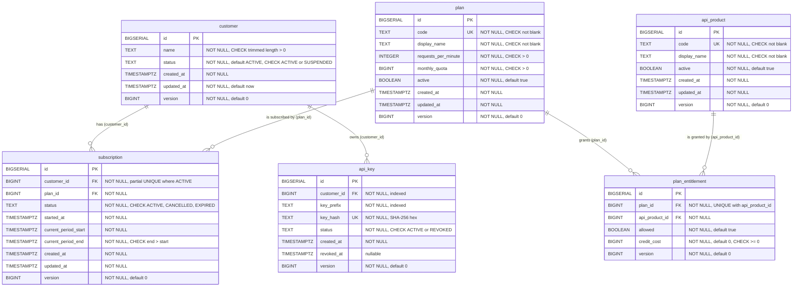
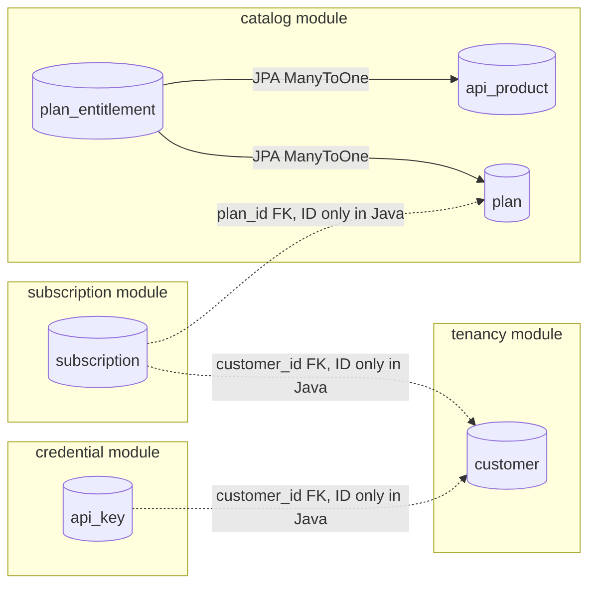

# Entity Relationship Diagram

> Part of the [MeterFlow Technical Documentation](../README.md). Column-level detail is in [Database Design](database-design.md).
>
> Source: [`../diagrams/database-erd.mmd`](../diagrams/database-erd.mmd)

## Relationship Explanation

| Relationship | Cardinality | Enforced by | JPA mapping | Business meaning |
|---|---|---|---|---|
| `customer` → `subscription` | 1 : 0..N (and at most **1 ACTIVE**) | `fk_subscription_customer` + `uq_subscription_active_per_customer` | `Subscription.customerId` (`Long`, no association) | A customer's subscription history. Only one subscription is current |
| `customer` → `api_key` | 1 : 0..N | `fk_api_key_customer` | `ApiKey.customerId` (`Long`) | A customer may hold several keys (for example, for rotation) |
| `plan` → `subscription` | 1 : 0..N | `fk_subscription_plan` | `Subscription.planId` (`Long`) | Which tier the customer is on |
| `plan` → `plan_entitlement` | 1 : 0..N | `fk_plan_entitlement_plan` | `@ManyToOne(LAZY) PlanEntitlement.plan` | Products available in the plan |
| `api_product` → `plan_entitlement` | 1 : 0..N | `fk_plan_entitlement_product` | `@ManyToOne(LAZY) PlanEntitlement.apiProduct` | Plans that include the product |
| `plan` ↔ `api_product` | N : M via `plan_entitlement` | `uq_plan_entitlement_plan_product` | — | Many-to-many with attributes (`allowed`, `credit_cost`) |

## Module Ownership of Tables

**Explanation:** Each table belongs to exactly one module. Inside a module, JPA associations are used (solid lines). Across modules, the database keeps referential integrity with FKs, but the Java model holds only the ID (dotted lines). This keeps module boundaries explicit and prevents lazy loading from crossing modules.
