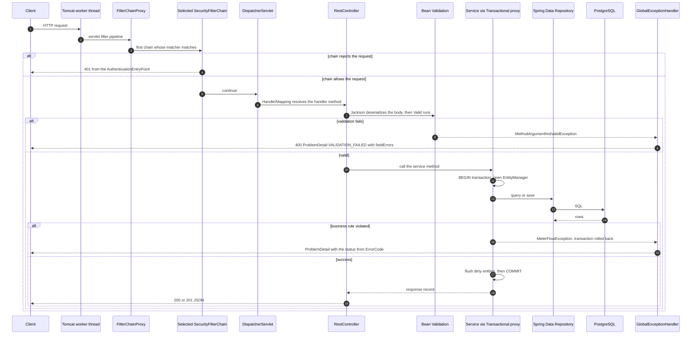
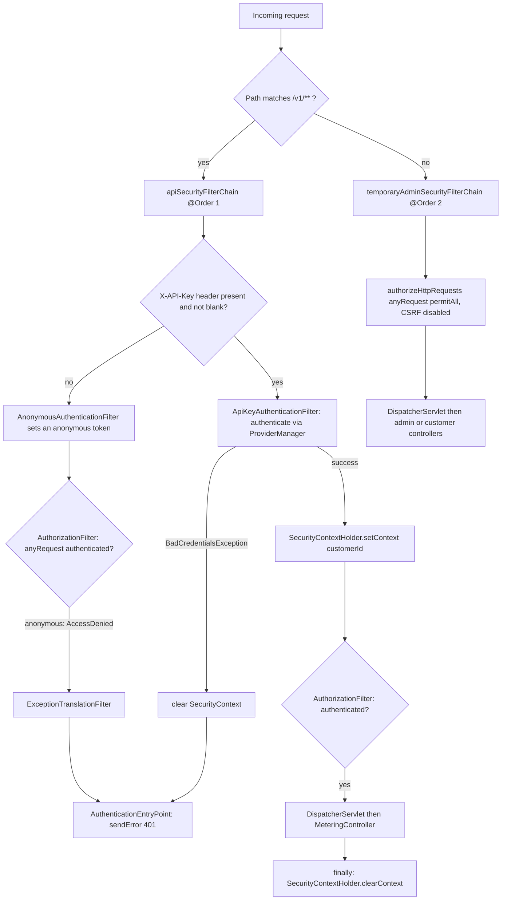
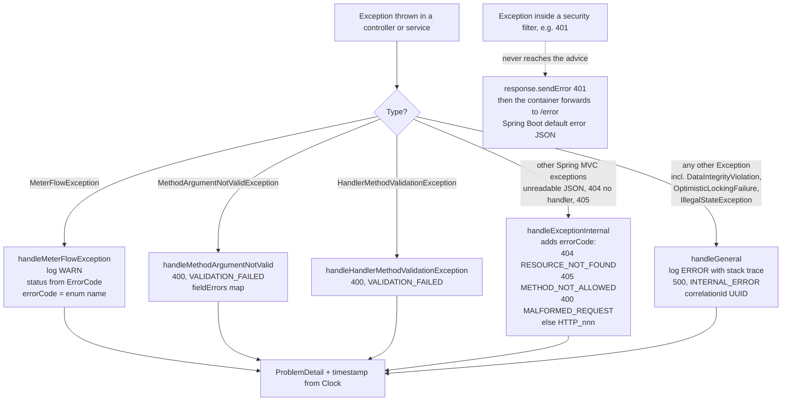
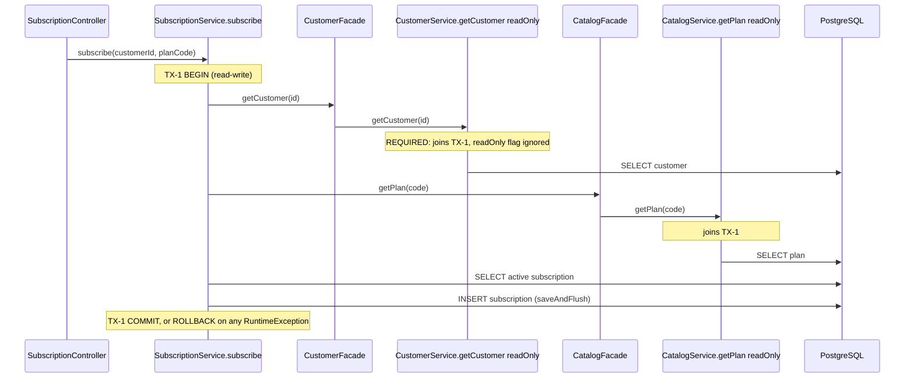
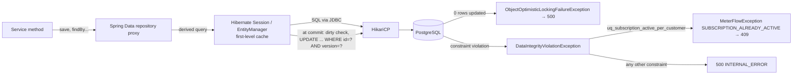
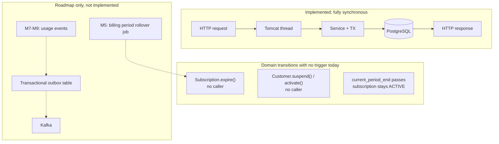

# Application Flow

> Part of the [MeterFlow Technical Documentation](../README.md). This document explains how a request travels through the system and the cross-cutting mechanisms it meets on the way: security, validation, error handling, transactions and background processing.

## Table of Contents

1. [Request Lifecycle](#1-request-lifecycle)
2. [Security Filter Chain Selection](#2-security-filter-chain-selection)
3. [Controller Layer Conventions](#3-controller-layer-conventions)
4. [Service Layer Conventions](#4-service-layer-conventions)
5. [Validation](#5-validation)
6. [Exception Handling](#6-exception-handling)
7. [Transaction Management](#7-transaction-management)
8. [Persistence Interaction](#8-persistence-interaction)
9. [Background Jobs and Asynchronous Processing](#9-background-jobs-and-asynchronous-processing)
10. [Logging and Observability](#10-logging-and-observability)
11. [Time Handling](#11-time-handling)

---

## 1. Request Lifecycle

**Explanation**

1. Tomcat gives each request a worker thread. Everything that follows runs **synchronously on that thread**: the security context in `ThreadLocal`, the transaction and the JDBC connection.
2. `FilterChainProxy` picks a single `SecurityFilterChain`. See [§2](#2-security-filter-chain-selection).
3. `DispatcherServlet` routes the request to a controller method. Jackson turns the JSON into an immutable `record`, and `@Valid` triggers Jakarta Bean Validation.
4. Controllers are thin. They pass the call to a `@Service`, whose `@Transactional` proxy opens a transaction.
5. Business-rule violations are raised as `MeterFlowException`. Because it is a `RuntimeException`, the transaction rolls back, and `GlobalExceptionHandler` turns it into a `ProblemDetail`.
6. On success, Hibernate flushes any dirty managed entities on commit. That is how update endpoints work without calling `save()`.

## 2. Security Filter Chain Selection

Configured in [`SecurityConfig`](../../src/main/java/com/meterflow/security/SecurityConfig.java):

| Setting | `apiSecurityFilterChain` (`@Order(1)`) | `temporaryAdminSecurityFilterChain` (`@Order(2)`) |
|---|---|---|
| Matcher | `securityMatcher("/v1/**")` | none, so any request |
| CSRF | disabled | disabled |
| Session | `STATELESS` | Spring default |
| Authorization | `anyRequest().authenticated()` | `anyRequest().permitAll()` |
| Custom filter | `ApiKeyAuthenticationFilter`, placed before `UsernamePasswordAuthenticationFilter` | — |
| Entry point | lambda: `response.sendError(401, "Unauthorized")` | default |
| `AuthenticationManager` | a local `new ProviderManager(apiKeyAuthenticationProvider)` | — |

The authentication internals are covered in detail in [Security](security.md).

## 3. Controller Layer Conventions

| Convention | Example |
|---|---|
| Constructor injection, no field injection | `CatalogAdminController(CatalogService)` |
| `ResponseEntity` with an explicit status for creates (`201 CREATED`) | `ResponseEntity.status(HttpStatus.CREATED).body(response)` |
| Request bodies are records annotated `@Valid @RequestBody` | `CreatePlanRequest` |
| Resources addressed by **business code** (catalog) or **numeric ID** (customer, key) | `/admin/plans/{code}`, `/admin/customers/{customerId}/api-keys/{apiKeyId}` |
| Path variables are not validated in the controller. Blank-code checks live in the service | `CatalogService.getPlanByCode` |
| Data-plane controllers take identity from `CurrentCustomer`, **never** from the request | `MeteringController.recordUsage` |

## 4. Service Layer Conventions

| Convention | Example |
|---|---|
| One `@Service` per module owns all of its business rules | `CatalogService`, `SubscriptionService` |
| Every public method declares `@Transactional`, with `readOnly = true` for reads | `CatalogService.getPlans` |
| Codes are normalized with `trim().toUpperCase(Locale.ROOT)` before any lookup | All catalog methods |
| Timestamps come from `Instant.now(clock)` | Every create and update |
| Entities are mutated through domain methods, then saved by dirty checking (no `save()` on update) | `CatalogService.updatePlan` |
| Responses are mapped while the transaction is still open (required because `open-in-view: false`) | `PlanEntitlementResponse.from(entitlement)` touches LAZY associations |
| Errors are raised as `new MeterFlowException(ErrorCode.X, "message")` | Everywhere |

## 5. Validation

Validation happens in three layers:

| Layer | Mechanism | Failure → response |
|---|---|---|
| 1. Request body | Jakarta constraints on records + `@Valid` | `MethodArgumentNotValidException` → `400`, `errorCode=VALIDATION_FAILED`, `fieldErrors` map |
| 1b. Method parameter | Constraint on a handler parameter (`@Min(0) int page`). Spring MVC built-in method validation | `HandlerMethodValidationException` → `400`, `VALIDATION_FAILED` (without `fieldErrors`) |
| 2. Service | Explicit checks (blank path code, blank `displayName` on patch, entity status) | `MeterFlowException` → status from `ErrorCode` |
| 3. Database | `CHECK`, `NOT NULL`, `UNIQUE`, FK constraints | `DataIntegrityViolationException`. It is translated to `409` **only** for `uq_subscription_active_per_customer`. Every other violation becomes a `500` |

Request constraint inventory:

| Record | Field | Constraint(s) |
|---|---|---|
| `CreateCustomerRequest` | `name` | `@NotBlank` |
| `CreateApiProductRequest` | `code`, `displayName` | `@NotBlank` |
| `UpdateApiProductRequest` | `active` | `@NotNull` |
| `CreatePlanRequest` | `code`, `displayName` | `@NotBlank` |
| | `requestsPerMinute` | `@NotNull @Positive` |
| | `monthlyQuota` | `@NotNull @Positive` |
| `UpdatePlanRequest` | `requestsPerMinute`, `monthlyQuota` | `@Positive` (nullable, meaning "unchanged") |
| | `displayName`, `active` | none (blank `displayName` is rejected in the service) |
| `UpsertPlanEntitlementRequest` | `allowed` | `@NotNull` |
| | `creditCost` | `@NotNull @PositiveOrZero` |
| `CreateSubscriptionRequest` | `planCode` | `@NotBlank` |
| `MeteredRequest` | `productCode` | `@NotBlank` |
| `CatalogAdminController.getApiProductsByPage` | `page` | `@Min(0)`, default `0` |

## 6. Exception Handling

[`GlobalExceptionHandler`](../../src/main/java/com/meterflow/common/error/GlobalExceptionHandler.java) extends `ResponseEntityExceptionHandler` and always produces `ProblemDetail` (RFC 7807, `application/problem+json`).

**Important behaviours**

- **Internal details never leak.** Unexpected errors return the generic message `"An unexpected error occurred"` plus a `correlationId`. The same ID is logged together with the stack trace, so support can match the two.
- **Security errors are outside this contract.** `401` responses come from `response.sendError`, so the body is Spring Boot's default error JSON, not a `ProblemDetail` with `errorCode`. **[Unverified]** The exact body depends on Boot's `ErrorAttributes` defaults. The tests assert only the status.
- **Concurrency conflicts are not mapped.** `ErrorCode.CONCURRENT_MODIFICATION` (409) exists, but no handler maps `ObjectOptimisticLockingFailureException` to it, so such conflicts surface as `500`.

## 7. Transaction Management

| Aspect | Behaviour |
|---|---|
| Demarcation | Declarative `@Transactional` (Spring) on public service methods |
| Read operations | `@Transactional(readOnly = true)`: Hibernate uses manual flush mode, so no dirty checking happens on commit |
| Propagation | Default `REQUIRED`. A facade call from another service **joins** the caller's transaction, and the inner method's `readOnly` flag is then ignored |
| Isolation | Database default: PostgreSQL `READ COMMITTED` |
| Rollback | Default rules: any `RuntimeException` (including `MeterFlowException`) marks the transaction rollback-only |
| Open Session in View | **Disabled** (`spring.jpa.open-in-view: false`). Lazy associations must be accessed inside the service |
| Flush timing | Normally at commit. `SubscriptionService.subscribe` calls `saveAndFlush` on purpose so that a unique-index violation is raised **inside** its `try/catch` |

Transactional boundaries per service method:

| Method | Annotation | Notes |
|---|---|---|
| `CustomerService.getCustomer` | `readOnly` | |
| `CustomerService.createCustomer` | read-write | |
| `CustomerService.getAll` | **none** | Relies on the repository's own transaction |
| `CatalogService.getPlan`, `getPlans`, `getPlanByCode`, `getAllApiProducts`, `getApiProduct`, `findEntitlement` | `readOnly` | |
| `CatalogService.createPlan`, `updatePlan`, `createApiProduct`, `updateApiProductStatus`, `updatePlanEntitlement` | read-write | Updates rely on dirty checking |
| `SubscriptionService.subscribe`, `cancelActiveSubscription` | read-write | |
| `SubscriptionService.getActiveSubscription` | read-write | Could be `readOnly` |
| `SubscriptionService.findActiveSubscription` | `readOnly` | Used by `SubscriptionFacade` (data plane) |
| `ApiKeyService.createApiKey`, `revokeApiKey` | read-write | |
| `ApiKeyService.listApiKeys` | `readOnly` | |
| `MeteringService.authorize` | `readOnly` | One transaction for the four authorization reads. The facade methods it calls join it (`REQUIRED`). **[Roadmap]** Becomes read-write in M4 when the debit is added |
| `ApiKeyAuthenticationProvider.authenticate` | **none** | `findByKeyHash` runs in Spring Data's default read-only repository transaction |

### Transaction propagation example: `subscribe`

## 8. Persistence Interaction

**Explanation:** All database access goes through Spring Data repositories. There is no native SQL, `@Query`, `JdbcTemplate` or Criteria API. Updates rely on Hibernate's dirty checking together with `@Version` optimistic locking. Constraint violations come back up as Spring's `DataIntegrityViolationException`, and only one of them is translated into a business error. Table-level details are in [Database Design](../database/database-design.md).

## 9. Background Jobs and Asynchronous Processing

**There is no background or asynchronous processing in the current code.** A search of `src/main` finds no `@Scheduled`, `@EnableScheduling`, `@Async`, `@EnableAsync`, `TaskExecutor`, message listeners, `ApplicationEvent` publishing or outbox tables.

The diagram below contrasts the current synchronous model with the asynchronous capabilities the roadmap expects. The roadmap part is **not implemented**.

**Consequences for operators:**

- A subscription whose `current_period_end` is in the past stays `ACTIVE`. Nothing expires or renews it.
- No endpoint suspends a customer. `CustomerStatus.SUSPENDED` can only be set directly in the database.

## 10. Logging and Observability

| Item | Current state |
|---|---|
| Application logging | Only in `GlobalExceptionHandler`: `WARN` for `MeterFlowException` and `ERROR` (with stack trace and `correlationId`) for unexpected exceptions |
| SQL logging | `spring.jpa.show-sql: true` in the `local` profile |
| Health | `/actuator/health` |
| Metrics, tracing | Not configured |
| Request correlation ID | Not present. The `correlationId` is generated only for `500` responses |
| Audit trail | Not present. Entities carry `created_at` / `updated_at`, and `api_key.revoked_at` |

## 11. Time Handling

- [`TimeConfig`](../../src/main/java/com/meterflow/config/TimeConfig.java) provides `Clock.systemUTC()`.
- All persisted timestamps are `Instant` mapped to `TIMESTAMPTZ`.
- Subscription period arithmetic is done in UTC: `now.atZone(ZoneOffset.UTC).plusMonths(1).toInstant()`.
- The `Clock` can be replaced in tests (`Clock.fixed`), but the current tests use `Instant.now()` directly when they create fixtures.
