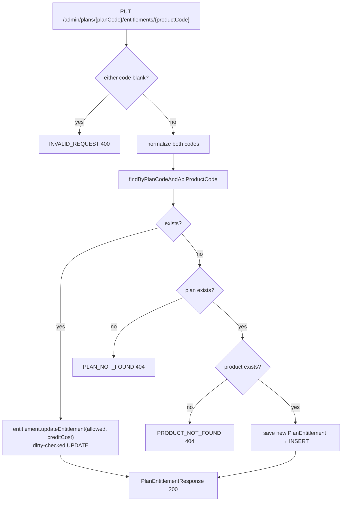
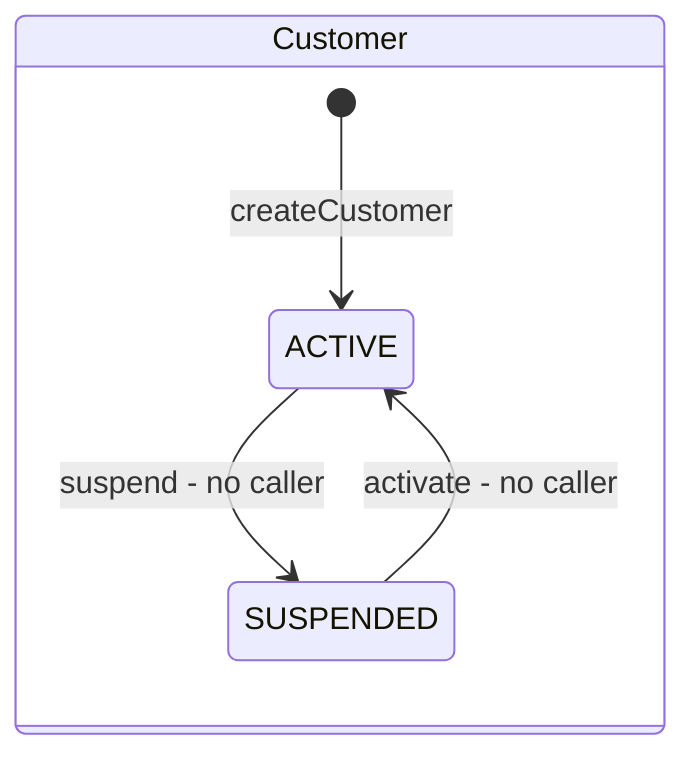
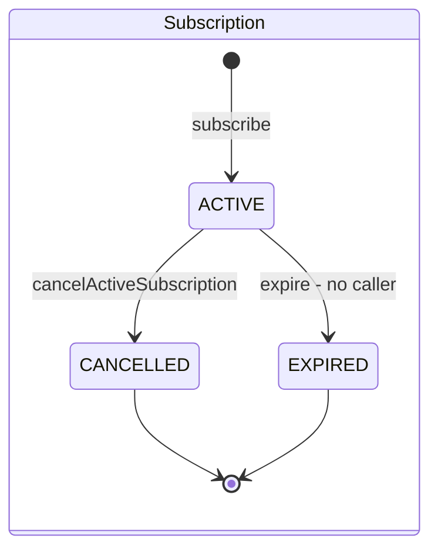
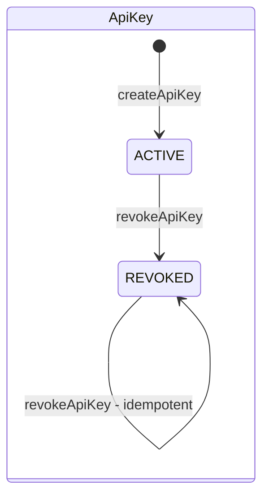
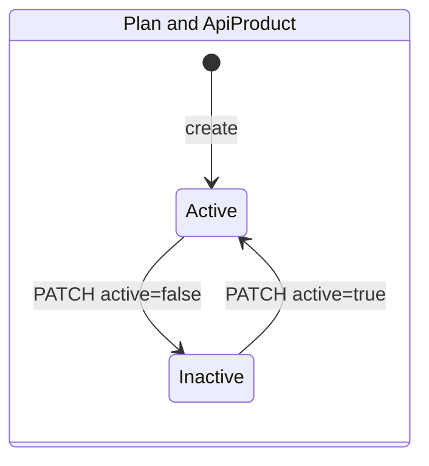

# Business Logic

> Part of the [MeterFlow Technical Documentation](../README.md). This document gives a method-level description of the business rules in each module. Sequence diagrams for the main flows are in [Workflows › Sequence Diagrams](../workflows/sequence-diagrams.md).

## Table of Contents

1. [Tenancy](#1-tenancy)
2. [Catalog](#2-catalog)
3. [Subscription](#3-subscription)
4. [Credentials (API Keys)](#4-credentials-api-keys)
5. [Metering Gateway — M3](#5-metering-gateway--m3)
6. [Business Rule Matrix](#6-business-rule-matrix)
7. [Entity State Machines](#7-entity-state-machines)

---

## 1. Tenancy

Source: [`CustomerService`](../../src/main/java/com/meterflow/tenancy/service/CustomerService.java)

| Method | Rules | Errors |
|---|---|---|
| `createCustomer(String name)` | Creates a `Customer` with `status = ACTIVE` and `createdAt = updatedAt = now`. The name is stored **as received**, without trimming | DB `chk_customer_name_not_blank` as a backstop (the request is already `@NotBlank`) |
| `getCustomer(Long id)` | Returns `CustomerView(id, name, status)` | `CUSTOMER_NOT_FOUND` (404) |
| `getAll()` | Returns every `Customer` **entity**, unpaginated | — |

## 2. Catalog

Source: [`CatalogService`](../../src/main/java/com/meterflow/catalog/service/CatalogService.java)

### 2.1 Code normalization

Every product and plan code, whether it comes from the body or the path, is normalized before it is used:

```java
String code = requestedCode.trim().toUpperCase(Locale.ROOT);
```

So `" sms "`, `"Sms"` and `"SMS"` all refer to the same product. `Locale.ROOT` avoids locale-specific case rules, such as Turkish dotless *i*.

### 2.2 API products

| Method | Rules | Errors |
|---|---|---|
| `createApiProduct(req)` | Normalize the code and trim `displayName`. Reject duplicates with `existsByCode`. New products start `active = true` | `DUPLICATE_RESOURCE` (409) |
| `getAllApiProducts(int page)` | `PageRequest.of(page, 10)`. The page size is fixed at 10 and the sort order is unspecified | — |
| `updateApiProductStatus(req, code)` | `active = true` → `activate(now)`, `false` → `deactivate(now)` | `PRODUCT_NOT_FOUND` (404) |
| `getApiProduct(code)` | Used by `CatalogFacade` / gateway. Returns `ApiProductView`. Does not check `active` itself; the gateway does | `VALIDATION_FAILED` (blank), `PRODUCT_NOT_FOUND` |
| `findEntitlement(planId, apiProductId)` | Used by `CatalogFacade` / gateway. Returns `Optional<EntitlementView>`; the caller decides what "absent" means | — |

### 2.3 Plans

| Method | Rules | Errors |
|---|---|---|
| `createPlan(req)` | Normalize the code, trim `displayName`, reject duplicates. New plans start `active = true` | `DUPLICATE_RESOURCE` |
| `getPlans()` | All plans, unpaginated | — |
| `getPlanByCode(code)` | Rejects a blank code | `VALIDATION_FAILED`, `PLAN_NOT_FOUND` |
| `getPlan(code)` | Facade variant that returns `PlanView` | `PLAN_NOT_FOUND` |
| `updatePlan(req, code)` | **Partial update**: every `null` field means "leave unchanged" (see below) | `PLAN_NOT_FOUND`, `VALIDATION_FAILED` |

`updatePlan` algorithm:

```java
if (req.active() != null)        → plan.activate(now) / plan.deactivate(now)
if (req.displayName() != null)   → trimmed; blank ⇒ VALIDATION_FAILED; else plan.rename(...)
if (req.monthlyQuota() != null || req.requestsPerMinute() != null)
                                 → plan.updateLimits(newOrCurrentRpm, newOrCurrentQuota, now)
// no save(): the managed entity is flushed by dirty checking at commit
```

The `active` change is applied **before** the `displayName` validation. If the name is blank, the exception rolls back the whole transaction, so no partial update is saved.

### 2.4 Plan entitlements

`updatePlanEntitlement(req, planCode, productCode)` is an **upsert**:



Notes:

- The response is always `200 OK`, even when a row was inserted.
- The plan and product are **not** required to be `active`.
- `creditCost` is a `long` ≥ 0, expressed in milli-credits by project convention (1 credit = 1,000). The code does not encode the unit; it stores and returns the integer as-is. See [§ 5.3](#53-business-decisions).

## 3. Subscription

Source: [`SubscriptionService`](../../src/main/java/com/meterflow/subscription/service/SubscriptionService.java)

### 3.1 `subscribe(customerId, planCode)`

| Step | Rule | Error |
|---|---|---|
| 1 | The customer must exist | `CUSTOMER_NOT_FOUND` 404 |
| 2 | The customer must be `ACTIVE` | `CUSTOMER_NOT_ACTIVE` 400 |
| 3 | The plan must exist (code normalized) | `PLAN_NOT_FOUND` 404 |
| 4 | The plan must be `active` | `PLAN_NOT_ACTIVE` 400 |
| 5 | Pre-check: no `ACTIVE` subscription for the customer | `SUBSCRIPTION_ALREADY_ACTIVE` 409 |
| 6 | Period = `[now, now + 1 calendar month in UTC)`, with `startedAt = currentPeriodStart = now` | — |
| 7 | `saveAndFlush`. If the DB raises a violation of `uq_subscription_active_per_customer`, it is translated to `SUBSCRIPTION_ALREADY_ACTIVE` 409. Any other integrity violation is rethrown and becomes a 500 | 409 / 500 |

**Why both a pre-check (step 5) and a DB constraint (step 7)?** The pre-check gives a clean error in the common, non-concurrent case. The partial unique index is the actual guarantee when two requests race, because both can pass step 5 under `READ COMMITTED`. [`SubscriptionConcurrencyIntegrationTest`](../../src/test/java/com/meterflow/subscription/SubscriptionConcurrencyIntegrationTest.java) covers this case.

Constraint detection walks the exception's cause chain:

```java
private boolean isActiveSubscriptionUniqueViolation(Throwable t) {
    for (Throwable c = t; c != null; c = c.getCause())
        if (c instanceof org.hibernate.exception.ConstraintViolationException ex)
            return "uq_subscription_active_per_customer".equals(ex.getConstraintName());
    return false;
}
```

### 3.2 `getActiveSubscription(customerId)` / `cancelActiveSubscription(customerId)`

- Both look up `findByCustomerIdAndStatus(customerId, ACTIVE)` and return `SUBSCRIPTION_NOT_FOUND` (404) if there is none.
- Neither checks that the customer exists. An unknown customer also gets `SUBSCRIPTION_NOT_FOUND`.
- Cancel sets `status = CANCELLED` and `updatedAt = now`. `currentPeriodEnd` is **not** changed. After a cancellation the customer can subscribe again (tested by `shouldAllowNewSubscriptionAfterCancellation`).

## 4. Credentials (API Keys)

Sources: [`ApiKeyService`](../../src/main/java/com/meterflow/credential/service/ApiKeyService.java), [`ApiKeyGenerator`](../../src/main/java/com/meterflow/credential/service/ApiKeyGenerator.java), [`ApiKeyHasher`](../../src/main/java/com/meterflow/credential/service/ApiKeyHasher.java)

### 4.1 Key format

```
mf_live_ + Base64URL-without-padding(32 bytes from SecureRandom)
└──8──┘    └────────────────── 43 chars ──────────────────┘     total 51 chars
prefix (stored, shown) = first 16 chars = "mf_live_" + first 8 chars of the secret
hash   (stored)        = lower-case hex SHA-256 of the full 51-char key (64 chars)
```

### 4.2 Operations

| Method | Rules | Errors |
|---|---|---|
| `createApiKey(customerId)` | The customer must exist (status is **not** checked). Generate, hash, then save `ApiKey(ACTIVE)`. Returns the **raw key once** | `CUSTOMER_NOT_FOUND` |
| `listApiKeys(customerId)` | The customer must exist. Returns all keys (active and revoked) without the raw key or hash | `CUSTOMER_NOT_FOUND` |
| `revokeApiKey(customerId, apiKeyId)` | The customer must exist. The key must exist **and belong to that customer**, otherwise `API_KEY_NOT_FOUND`, which avoids confirming that another customer's key exists. Idempotent: revoking a revoked key returns it unchanged, keeping the original `revokedAt` | `CUSTOMER_NOT_FOUND`, `API_KEY_NOT_FOUND` |

Authentication with these keys is described in [Security](security.md).

## 5. Metering Gateway — M3

Sources: [`MeteringController`](../../src/main/java/com/meterflow/gateway/api/MeteringController.java), [`MeteringService`](../../src/main/java/com/meterflow/gateway/service/MeteringService.java), [`UsageAuthorization`](../../src/main/java/com/meterflow/gateway/service/UsageAuthorization.java), [`MeteredResponse`](../../src/main/java/com/meterflow/gateway/api/MeteredResponse.java)

M3 answers two questions for every data-plane call: **is this customer allowed to call this product right now?** and **how much does the call cost?** It does not charge, record or throttle the call. Those are M4 and later.

### 5.1 Components

| Component | Module | Responsibility |
|---|---|---|
| `MeteringController` | `gateway.api` | `POST /v1/usage`. Validates the body (`@NotBlank productCode`), takes the customer ID from `CurrentCustomer` (the authenticated API key, never the body), calls `MeteringService.authorize`, and maps the result to `MeteredResponse` |
| `MeteringService` | `gateway.service` | Orchestrates the authorization checks in a single `@Transactional(readOnly = true)` method. Talks to other modules **only through their facades** |
| `UsageAuthorization` | `gateway.service` | Internal result of a successful authorization: `(customerId, subscriptionId, planId, apiProductId, productCode, creditCost)`. Carries everything the upcoming wallet debit (M4) needs |
| `MeteredResponse` | `gateway.api` | Public HTTP contract: `(customerId, productCode, subscriptionId, planId, creditCost)`. Built with `MeteredResponse.from(UsageAuthorization)` |
| `CustomerFacade.getCustomer(id)` | `tenancy` | Returns `CustomerView(id, name, status)`. Throws `404 CUSTOMER_NOT_FOUND` if missing |
| `CatalogFacade.getApiProduct(code)` | `catalog` | Normalizes the code (`trim` + upper case) and returns `ApiProductView(id, code, active)`. Throws `404 PRODUCT_NOT_FOUND` if missing |
| `CatalogFacade.findEntitlement(planId, productId)` | `catalog` | Returns `Optional<EntitlementView(id, allowed, creditCost)>`. The lookup is by IDs on the unique `(plan_id, api_product_id)` constraint, with no joins |
| `SubscriptionFacade.findActiveSubscription(customerId)` | `subscription` | Returns `Optional<SubscriptionView(id, customerId, planId, currentPeriodStart, currentPeriodEnd)>` for the customer's `ACTIVE` subscription |

The facades return `Optional` where "not found" is a **business decision for the caller** (no subscription, no entitlement → the gateway decides it means 403). They throw where "not found" means the same thing everywhere (unknown product → 404).

### 5.2 Authorization flow

`MeteringService.authorize(customerId, productCode)` runs these steps in order and stops at the first failure:

| # | Step | Source | Failure | HTTP |
|---|---|---|---|---|
| 0 | Body validation (`productCode` not blank) | `@Valid MeteredRequest` | `VALIDATION_FAILED` | 400 |
| 1 | Resolve the customer and require `status == ACTIVE` | `CustomerFacade.getCustomer` | `CUSTOMER_NOT_FOUND` / `CUSTOMER_SUSPENDED` | 404 / 403 |
| 2 | Product must exist, then must be `active` | `CatalogFacade.getApiProduct` | `PRODUCT_NOT_FOUND` / `PRODUCT_INACTIVE` | 404 / 403 |
| 3 | Customer must have an `ACTIVE` subscription | `SubscriptionFacade.findActiveSubscription` | `NO_ACTIVE_SUBSCRIPTION` | 403 |
| 4 | The subscription's plan must have an entitlement for the product with `allowed = true` | `CatalogFacade.findEntitlement(subscription.planId, product.id)` | `PRODUCT_NOT_ENTITLED` | 403 |
| 5 | Take the credit cost from the entitlement | `EntitlementView.creditCost` | — | — |
| 6 | Build `UsageAuthorization` | `MeteringService` | — | — |
| 7 | Convert to `MeteredResponse` and return `200 OK` | `MeteringController` | — | 200 |

`CUSTOMER_NOT_FOUND` is practically unreachable: the customer ID comes from an authenticated API key, and `api_key.customer_id` is a foreign key to `customer`. A request without a valid key is rejected earlier with `401` by the security filter chain.

```java
// MeteringService.authorize (abridged)
CustomerView customer = customerFacade.getCustomer(customerId);
if (customer.status() != CustomerStatus.ACTIVE) throw CUSTOMER_SUSPENDED;

ApiProductView product = catalogFacade.getApiProduct(productCode);
if (!product.active()) throw PRODUCT_INACTIVE;

SubscriptionView subscription = subscriptionFacade.findActiveSubscription(customerId)
        .orElseThrow(NO_ACTIVE_SUBSCRIPTION);

EntitlementView entitlement = catalogFacade.findEntitlement(subscription.planId(), product.id())
        .filter(EntitlementView::allowed)
        .orElseThrow(PRODUCT_NOT_ENTITLED);

return new UsageAuthorization(customerId, subscription.id(), subscription.planId(),
        product.id(), product.code(), entitlement.creditCost());
```

**Why this order:** the cheapest and broadest check runs first (a suspended customer is rejected without touching the catalog). Product comes before subscription so an unknown product code gets the more accurate `404`. The entitlement check comes last because it needs IDs from both the product and the subscription.

**Transactions:** all reads run inside one read-only transaction on one connection. The facades' own `@Transactional(readOnly = true)` methods join it (propagation `REQUIRED`). The result is four indexed point lookups per call.

### 5.3 Business decisions

| Decision | Behaviour | Verified by test |
|---|---|---|
| Missing entitlement = deny | No `plan_entitlement` row for (plan, product) → `403 PRODUCT_NOT_ENTITLED` | `shouldRejectProductMissingFromPlan` |
| `allowed = false` = deny | Same error as a missing row; the client cannot tell the two apart | `shouldRejectProductDisallowedByPlan` |
| Deactivated plan keeps existing subscribers | `plan.active` is **not** checked on the data plane. Deactivating a plan only blocks new subscriptions | `shouldKeepServingSubscribersAfterPlanIsDeactivated` |
| Canonical product code | The response returns the code as stored (`"  sms "` → `"SMS"`), not as sent | `shouldNormalizeProductCode` |
| Credit cost as `long` milli-credits | `creditCost` is a `long` (DB `BIGINT`), never floating point. By project convention 1 credit = 1,000 milli-credits; the code stores and returns the integer as-is and does not encode the unit | `shouldAuthorizeUsageAndReturnCreditCost` (`1500`) |
| `apiProductId` stays internal | Present in `UsageAuthorization` (needed by M4) but **not** in `MeteredResponse` | — |
| Subscription status only | Only `status = ACTIVE` is checked. `currentPeriodEnd` is **not** compared with the current time, so a subscription past its period end still authorizes calls until something marks it `EXPIRED` | — (known gap) |
| Suspended customer | `403 CUSTOMER_SUSPENDED`, even though the API key itself is still `ACTIVE` | `shouldRejectSuspendedCustomer` |

### 5.4 Implemented versus planned

| Capability | Status | Milestone |
|---|---|---|
| Usage API `POST /v1/usage` | ✅ Implemented | M3 |
| Customer resolution from API key | ✅ Implemented | M2/M3 |
| Customer status check | ✅ Implemented | M3 |
| Product existence + active check | ✅ Implemented | M3 |
| Active subscription check (status only) | ✅ Implemented | M3 |
| Entitlement check | ✅ Implemented | M3 |
| Credit-cost resolution | ✅ Implemented (returned, not charged) | M3 |
| Wallet debit / ledger | ❌ Not implemented | **[Roadmap]** M4 |
| Usage record / usage event persistence | ❌ Not implemented. A call leaves no trace in the database | **[Roadmap]** M4 / M7–M9 |
| Billing-period expiry (`currentPeriodEnd`) | ❌ Not checked | **[Roadmap]** M5 |
| Monthly quota enforcement | ❌ Not implemented (`plan.monthly_quota` is stored but unused) | **[Roadmap]** M5 |
| Idempotency keys | ❌ Not implemented. A retried call is authorized again | **[Roadmap]** M6 |
| Rate limiting | ❌ Not implemented (`plan.requests_per_minute` is stored but unused) | **[Roadmap]** M7–M9 (provisional) |

## 6. Business Rule Matrix

| Rule | Enforced in application | Enforced in database |
|---|---|---|
| Product and plan codes unique | `existsByCode` pre-check → 409 | `UNIQUE(code)` (a race gives 500) |
| Codes case-insensitive | Normalization to upper case | — |
| Names not blank | `@NotBlank` / service checks | `CHECK (length(trim(x)) > 0)` |
| `requestsPerMinute > 0`, `monthlyQuota > 0` | `@Positive` | `CHECK > 0` |
| `creditCost >= 0` | `@PositiveOrZero` | `CHECK >= 0` |
| One entitlement per (plan, product) | Upsert logic | `UNIQUE (plan_id, api_product_id)` (a race gives 500) |
| One `ACTIVE` subscription per customer | Pre-check → 409 | Partial unique index → translated to 409 |
| Subscription period end > start | Computed `+1 month` | `CHECK` |
| Subscribe only if customer `ACTIVE` and plan active | Service | — |
| API key hash unique | — | `UNIQUE(key_hash)` |
| Revoked key cannot authenticate | `ApiKeyAuthenticationProvider` | — |
| Status values | Java enums with `@Enumerated(STRING)` | `CHECK status IN (...)` |

## 7. Entity State Machines









**Explanation:** Transitions marked *no caller* exist as domain methods, but no endpoint or job invokes them. The other transitions are reachable through the API endpoints listed in the [API Reference](../api/api-reference.md).
