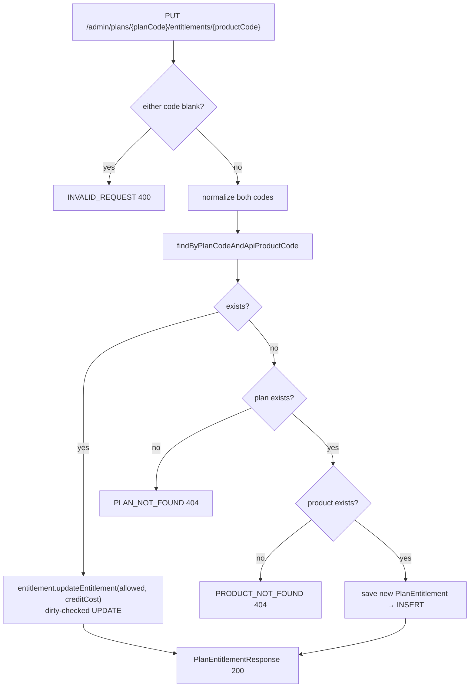
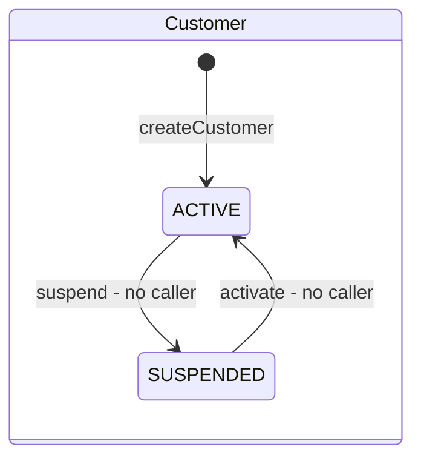
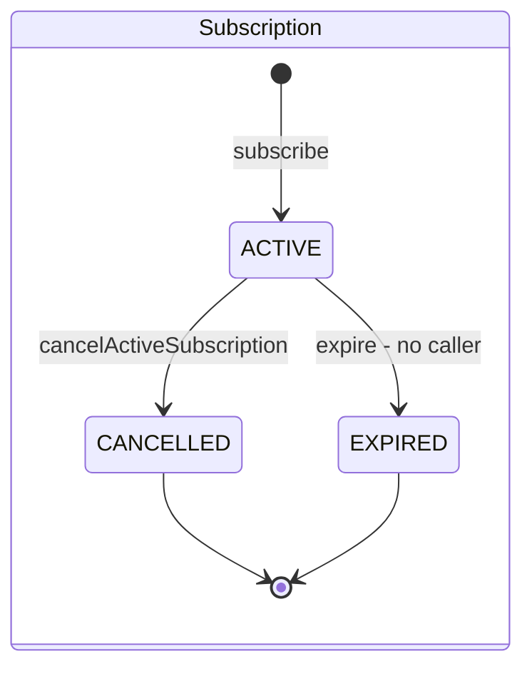
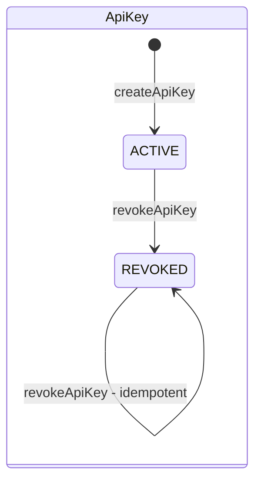
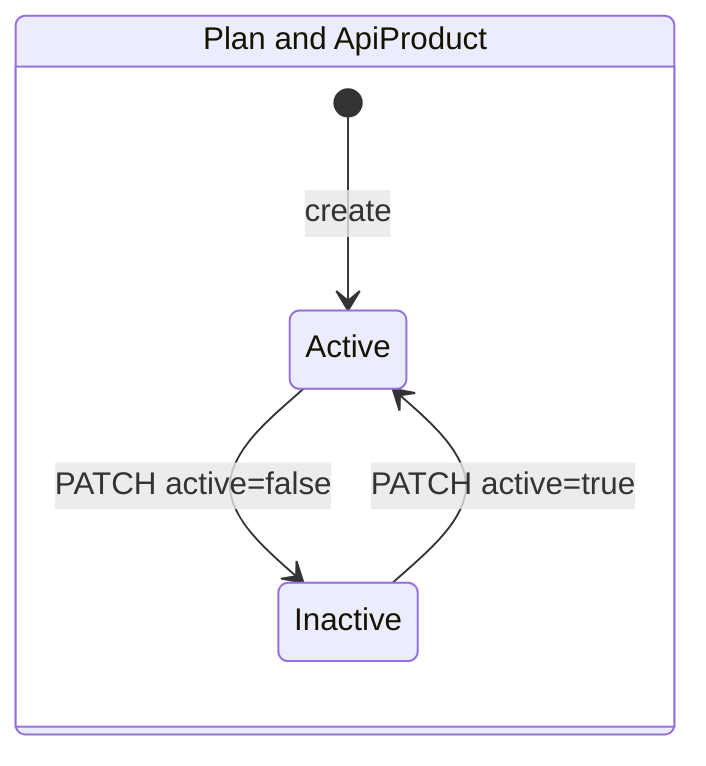

# Business Logic

> Part of the [MeterFlow Technical Documentation](../README.md). This document gives a method-level description of the business rules in each module. Sequence diagrams for the main flows are in [Workflows › Sequence Diagrams](../workflows/sequence-diagrams.md).

## Table of Contents

1. [Tenancy](#1-tenancy)
2. [Catalog](#2-catalog)
3. [Subscription](#3-subscription)
4. [Credentials (API Keys)](#4-credentials-api-keys)
5. [Metering Gateway — M3 (in progress)](#5-metering-gateway--m3-in-progress)
6. [Business Rule Matrix](#6-business-rule-matrix)
7. [Entity State Machines](#7-entity-state-machines)

---

## 1. Tenancy

Source: [`CustomerService`](../../src/main/java/com/meterflow/tenancy/service/CustomerService.java)

| Method | Rules | Errors |
|---|---|---|
| `createCustomer(String name)` | Creates a `Customer` with `status = ACTIVE` and `createdAt = updatedAt = now`. The name is stored **as received**, without trimming | DB `chk_customer_name_not_blank` as a backstop (the request is already `@NotBlank`) |
| `getCustomer(Long id)` | Returns `CustomerView(id, name, status)` | `CUSTOMER_NOT_FOUND` (404) |
| `getAll()` | Returns every `Customer` **entity**, unpaginated | — |

## 2. Catalog

Source: [`CatalogService`](../../src/main/java/com/meterflow/catalog/service/CatalogService.java)

### 2.1 Code normalization

Every product and plan code, whether it comes from the body or the path, is normalized before it is used:

```java
String code = requestedCode.trim().toUpperCase(Locale.ROOT);
```

So `" sms "`, `"Sms"` and `"SMS"` all refer to the same product. `Locale.ROOT` avoids locale-specific case rules, such as Turkish dotless *i*.

### 2.2 API products

| Method | Rules | Errors |
|---|---|---|
| `createApiProduct(req)` | Normalize the code and trim `displayName`. Reject duplicates with `existsByCode`. New products start `active = true` | `DUPLICATE_RESOURCE` (409) |
| `getAllApiProducts(int page)` | `PageRequest.of(page, 10)`. The page size is fixed at 10 and the sort order is unspecified | — |
| `updateApiProductStatus(req, code)` | `active = true` → `activate(now)`, `false` → `deactivate(now)` | `PRODUCT_NOT_FOUND` (404) |
| `getApiProduct(code)` | Used by `CatalogFacade` / gateway. **Does not check `active`** | `VALIDATION_FAILED` (blank), `PRODUCT_NOT_FOUND` |

### 2.3 Plans

| Method | Rules | Errors |
|---|---|---|
| `createPlan(req)` | Normalize the code, trim `displayName`, reject duplicates. New plans start `active = true` | `DUPLICATE_RESOURCE` |
| `getPlans()` | All plans, unpaginated | — |
| `getPlanByCode(code)` | Rejects a blank code | `VALIDATION_FAILED`, `PLAN_NOT_FOUND` |
| `getPlan(code)` | Facade variant that returns `PlanView` | `PLAN_NOT_FOUND` |
| `updatePlan(req, code)` | **Partial update**: every `null` field means "leave unchanged" (see below) | `PLAN_NOT_FOUND`, `VALIDATION_FAILED` |

`updatePlan` algorithm:

```java
if (req.active() != null)        → plan.activate(now) / plan.deactivate(now)
if (req.displayName() != null)   → trimmed; blank ⇒ VALIDATION_FAILED; else plan.rename(...)
if (req.monthlyQuota() != null || req.requestsPerMinute() != null)
                                 → plan.updateLimits(newOrCurrentRpm, newOrCurrentQuota, now)
// no save(): the managed entity is flushed by dirty checking at commit
```

The `active` change is applied **before** the `displayName` validation. If the name is blank, the exception rolls back the whole transaction, so no partial update is saved.

### 2.4 Plan entitlements

`updatePlanEntitlement(req, planCode, productCode)` is an **upsert**:



Notes:

- The response is always `200 OK`, even when a row was inserted.
- The plan and product are **not** required to be `active`.
- `creditCost` is a `long` ≥ 0. **[Roadmap]** It is intended to be expressed in milli-credits (1 credit = 1,000). The code does not define the unit **[Unverified]**.

## 3. Subscription

Source: [`SubscriptionService`](../../src/main/java/com/meterflow/subscription/service/SubscriptionService.java)

### 3.1 `subscribe(customerId, planCode)`

| Step | Rule | Error |
|---|---|---|
| 1 | The customer must exist | `CUSTOMER_NOT_FOUND` 404 |
| 2 | The customer must be `ACTIVE` | `CUSTOMER_NOT_ACTIVE` 400 |
| 3 | The plan must exist (code normalized) | `PLAN_NOT_FOUND` 404 |
| 4 | The plan must be `active` | `PLAN_NOT_ACTIVE` 400 |
| 5 | Pre-check: no `ACTIVE` subscription for the customer | `SUBSCRIPTION_ALREADY_ACTIVE` 409 |
| 6 | Period = `[now, now + 1 calendar month in UTC)`, with `startedAt = currentPeriodStart = now` | — |
| 7 | `saveAndFlush`. If the DB raises a violation of `uq_subscription_active_per_customer`, it is translated to `SUBSCRIPTION_ALREADY_ACTIVE` 409. Any other integrity violation is rethrown and becomes a 500 | 409 / 500 |

**Why both a pre-check (step 5) and a DB constraint (step 7)?** The pre-check gives a clean error in the common, non-concurrent case. The partial unique index is the actual guarantee when two requests race, because both can pass step 5 under `READ COMMITTED`. [`SubscriptionConcurrencyIntegrationTest`](../../src/test/java/com/meterflow/subscription/SubscriptionConcurrencyIntegrationTest.java) covers this case.

Constraint detection walks the exception's cause chain:

```java
private boolean isActiveSubscriptionUniqueViolation(Throwable t) {
    for (Throwable c = t; c != null; c = c.getCause())
        if (c instanceof org.hibernate.exception.ConstraintViolationException ex)
            return "uq_subscription_active_per_customer".equals(ex.getConstraintName());
    return false;
}
```

### 3.2 `getActiveSubscription(customerId)` / `cancelActiveSubscription(customerId)`

- Both look up `findByCustomerIdAndStatus(customerId, ACTIVE)` and return `SUBSCRIPTION_NOT_FOUND` (404) if there is none.
- Neither checks that the customer exists. An unknown customer also gets `SUBSCRIPTION_NOT_FOUND`.
- Cancel sets `status = CANCELLED` and `updatedAt = now`. `currentPeriodEnd` is **not** changed. After a cancellation the customer can subscribe again (tested by `shouldAllowNewSubscriptionAfterCancellation`).

## 4. Credentials (API Keys)

Sources: [`ApiKeyService`](../../src/main/java/com/meterflow/credential/service/ApiKeyService.java), [`ApiKeyGenerator`](../../src/main/java/com/meterflow/credential/service/ApiKeyGenerator.java), [`ApiKeyHasher`](../../src/main/java/com/meterflow/credential/service/ApiKeyHasher.java)

### 4.1 Key format

```
mf_live_ + Base64URL-without-padding(32 bytes from SecureRandom)
└──8──┘    └────────────────── 43 chars ──────────────────┘     total 51 chars
prefix (stored, shown) = first 16 chars = "mf_live_" + first 8 chars of the secret
hash   (stored)        = lower-case hex SHA-256 of the full 51-char key (64 chars)
```

### 4.2 Operations

| Method | Rules | Errors |
|---|---|---|
| `createApiKey(customerId)` | The customer must exist (status is **not** checked). Generate, hash, then save `ApiKey(ACTIVE)`. Returns the **raw key once** | `CUSTOMER_NOT_FOUND` |
| `listApiKeys(customerId)` | The customer must exist. Returns all keys (active and revoked) without the raw key or hash | `CUSTOMER_NOT_FOUND` |
| `revokeApiKey(customerId, apiKeyId)` | The customer must exist. The key must exist **and belong to that customer**, otherwise `API_KEY_NOT_FOUND`, which avoids confirming that another customer's key exists. Idempotent: revoking a revoked key returns it unchanged, keeping the original `revokedAt` | `CUSTOMER_NOT_FOUND`, `API_KEY_NOT_FOUND` |

Authentication with these keys is described in [Security](security.md).

## 5. Metering Gateway — M3 (in progress)

Sources: [`MeteringController`](../../src/main/java/com/meterflow/gateway/api/MeteringController.java), [`MeteringService`](../../src/main/java/com/meterflow/gateway/service/MeteringService.java)

### 5.1 Implemented behaviour

```java
// MeteringController.recordUsage
Long customerId = currentCustomer.getCustomerId();          // from the API key, never from the body
return ok(meteringService.process(customerId, request.productCode()));

// MeteringService.process
catalogFacade.getApiProduct(productCode);                   // 404 PRODUCT_NOT_FOUND if missing
return new MeteredResponse(customerId, productCode);        // productCode echoed exactly as received
```

### 5.2 M3 scope versus implementation

| M3 deliverable **[Roadmap]** | Implemented? | Notes |
|---|---|---|
| Usage API | ✅ | `POST /v1/usage` |
| Customer resolution | ✅ | `CurrentCustomer` |
| Product validation | ⚠️ Partial | Checks existence only. An inactive product is accepted |
| Subscription validation | ❌ | — |
| Entitlement checks | ❌ | — |
| Credit cost resolution | ❌ | — |
| Customer status check | ❌ | A `SUSPENDED` customer with an active key is accepted |
| Response uses the normalized code | ❌ | `"sms"` is echoed back as `"sms"` |

### 5.3 Data available for completing M3

Everything needed to finish M3 already exists in the schema:

| Check | Source |
|---|---|
| Customer active | `customer.status` via `CustomerFacade.getCustomer` |
| Product active | `api_product.active` |
| Active subscription and plan | `subscription WHERE customer_id=? AND status='ACTIVE'` (at most one row, guaranteed by the partial unique index) |
| Entitlement allowed + cost | `plan_entitlement WHERE plan_id=? AND api_product_id=?` (at most one row, guaranteed by `uq_plan_entitlement_plan_product`) |

Points not yet decided in the code **[Unverified]**:

- Should an existing subscription keep working when its plan is later deactivated?
- Should a missing entitlement row be treated as "deny"?
- Which HTTP status and error codes should the data plane use when it rejects a request?

## 6. Business Rule Matrix

| Rule | Enforced in application | Enforced in database |
|---|---|---|
| Product and plan codes unique | `existsByCode` pre-check → 409 | `UNIQUE(code)` (a race gives 500) |
| Codes case-insensitive | Normalization to upper case | — |
| Names not blank | `@NotBlank` / service checks | `CHECK (length(trim(x)) > 0)` |
| `requestsPerMinute > 0`, `monthlyQuota > 0` | `@Positive` | `CHECK > 0` |
| `creditCost >= 0` | `@PositiveOrZero` | `CHECK >= 0` |
| One entitlement per (plan, product) | Upsert logic | `UNIQUE (plan_id, api_product_id)` (a race gives 500) |
| One `ACTIVE` subscription per customer | Pre-check → 409 | Partial unique index → translated to 409 |
| Subscription period end > start | Computed `+1 month` | `CHECK` |
| Subscribe only if customer `ACTIVE` and plan active | Service | — |
| API key hash unique | — | `UNIQUE(key_hash)` |
| Revoked key cannot authenticate | `ApiKeyAuthenticationProvider` | — |
| Status values | Java enums with `@Enumerated(STRING)` | `CHECK status IN (...)` |

## 7. Entity State Machines









**Explanation:** Transitions marked *no caller* exist as domain methods, but no endpoint or job invokes them. The other transitions are reachable through the API endpoints listed in the [API Reference](../api/api-reference.md).
