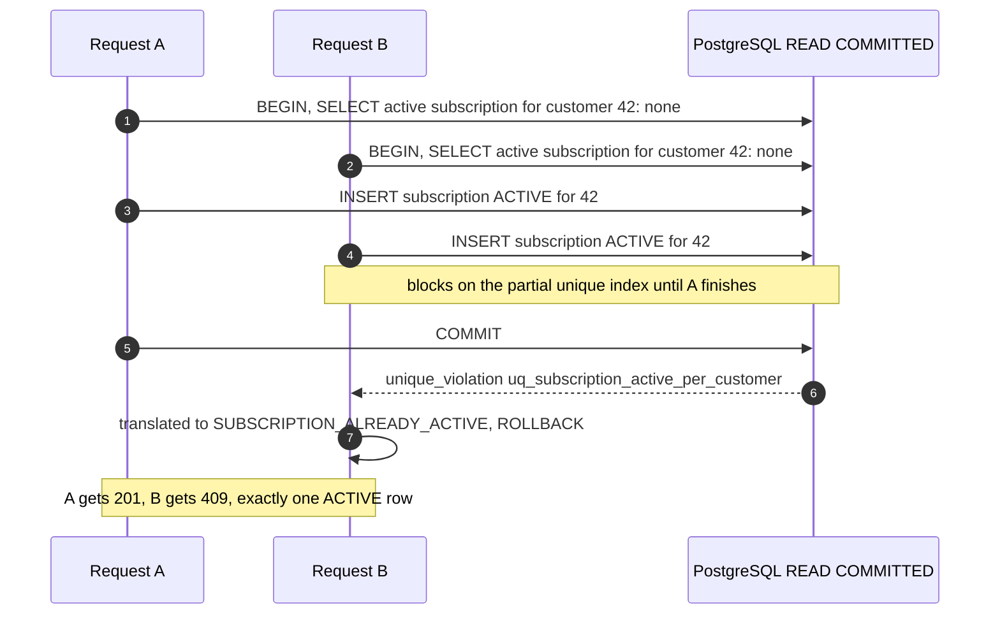
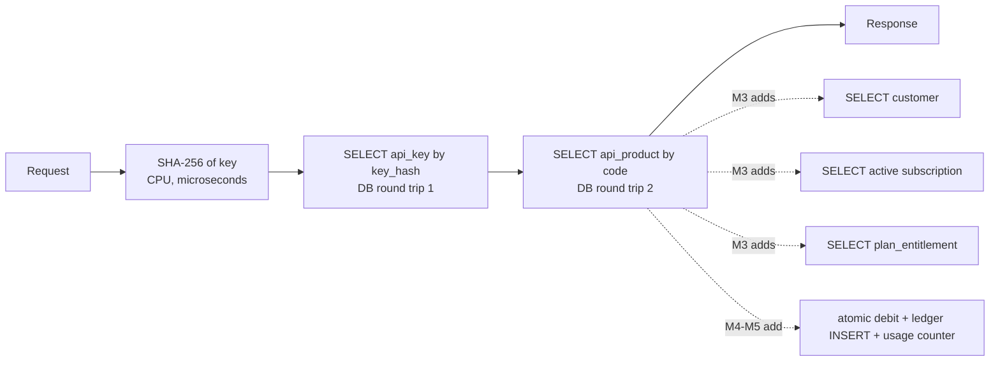

# Performance, Concurrency and Scalability

> Part of the [MeterFlow Technical Documentation](../README.md).

## Table of Contents

1. [Execution Model](#1-execution-model)
2. [Concurrency Control](#2-concurrency-control)
3. [Race Conditions Catalogue](#3-race-conditions-catalogue)
4. [Caching](#4-caching)
5. [Database Performance](#5-database-performance)
6. [Hot Path Analysis: `POST /v1/usage`](#6-hot-path-analysis-post-v1usage)
7. [Scalability](#7-scalability)
8. [Bottlenecks and Recommendations](#8-bottlenecks-and-recommendations)

---

## 1. Execution Model

- **Blocking Servlet stack.** Each request holds one Tomcat worker thread from start to finish, and also one JDBC connection while a transaction is open.
- No configuration overrides Tomcat's thread pool or HikariCP's pool size. Spring Boot defaults therefore apply **[Unverified exact values: typically 200 Tomcat threads and 10 Hikari connections]**.
- In practice, the number of requests that can touch the database at the same time is bounded by the **connection pool**.

## 2. Concurrency Control

| Mechanism | Where | Behaviour on conflict |
|---|---|---|
| Optimistic locking (`@Version`) | Every entity | Hibernate adds `AND version = ?` to each `UPDATE`. A conflict throws `ObjectOptimisticLockingFailureException`, which currently becomes **500** (`CONCURRENT_MODIFICATION` is not mapped) |
| Unique constraints | `code` columns, `key_hash`, `(plan_id, api_product_id)` | `DataIntegrityViolationException`, which becomes **500**, except for the next row |
| Partial unique index | `subscription(customer_id) WHERE status='ACTIVE'` | Translated to **409** `SUBSCRIPTION_ALREADY_ACTIVE` |
| Pessimistic locks | **Not used** | — |
| Atomic SQL updates | **Not used**. **[Roadmap]** M4 wallet debit will use them | — |

### Concurrent subscription example

## 3. Race Conditions Catalogue

| Scenario | Outcome today | Severity | Suggested fix |
|---|---|---|---|
| Two concurrent subscribes for one customer | ✅ One 201, one 409 | — | — |
| Two concurrent `createPlan` / `createApiProduct` with the same code | Both pass `existsByCode`. The second INSERT violates `UNIQUE`, giving **500** | Low | Catch `DataIntegrityViolationException` and return `DUPLICATE_RESOURCE` |
| Two concurrent first-time entitlement upserts for the same (plan, product) | Second INSERT violates `uq_plan_entitlement_plan_product`, giving **500** | Low | Same, or use `INSERT ... ON CONFLICT` |
| Two concurrent `PATCH /admin/plans/{code}` | Last writer hits a version conflict, giving **500** | Low | Map optimistic lock failures to `409 CONCURRENT_MODIFICATION` |
| Key revoked while a request is in flight | That request finishes as authenticated, because the key was checked at the start | Acceptable | — |
| **[Roadmap]** Concurrent credit debits (M4) and quota counting (M5) | Not implemented | High once implemented | Atomic conditional `UPDATE ... SET balance = balance - :cost WHERE balance >= :cost`, which is the roadmap decision. Don't use read-modify-write with `@Version` |

## 4. Caching

**No caching is configured.** There is no `@EnableCaching`, no Caffeine, no Redis and no Hibernate second-level cache. Each request reads fresh data, which also means a revoked key is rejected on the very next request.

Candidates, if latency becomes a concern:

| Data | Read frequency | Change frequency | Notes |
|---|---|---|---|
| API key hash → (customerId, status) | Every `/v1` request | Rare (create or revoke) | Must be invalidated on revoke. A short TTL is acceptable if a revocation delay is acceptable |
| Plan and entitlement by (planId, productId) | Every `/v1` request (after M3) | Rare | Invalidate on admin updates |
| API product by code | Every `/v1` request | Rare | |

In a multi-instance deployment, a local cache gives each instance its own view. Invalidation then needs a shared cache or a pub/sub signal.

## 5. Database Performance

| Topic | Observation |
|---|---|
| Indexed lookups on hot paths | `api_key.key_hash` (unique index), `api_product.code` and `plan.code` (unique indexes), `subscription(customer_id, status)` |
| Unindexed foreign keys | `plan_entitlement.api_product_id`, `subscription.plan_id`. Fine at current scale. Matters for joins or deletes on large tables. (`plan_entitlement.plan_id` is the leading column of the unique constraint, so it is covered) |
| Unused index | `idx_api_key_prefix`: write cost with no read benefit today |
| ID generation | `GenerationType.IDENTITY` (`BIGSERIAL`). Hibernate cannot batch INSERTs. This will matter for high-volume usage records later |
| Unpaginated lists | `GET /admin/plans`, `GET /customers`: full table scans that return every row |
| Lazy loading | `PlanEntitlement` → `Plan` and `ApiProduct` are `LAZY`. `PlanEntitlementResponse.from` loads both, giving up to two extra `SELECT`s per upsert (the update path) |
| Read-only transactions | `readOnly = true` reduces Hibernate flush and dirty-checking work on read paths |
| N+1 risks | None today, because no endpoint lists entitlements |

## 6. Hot Path Analysis: `POST /v1/usage`

**Explanation:** Today the hot path costs two indexed point lookups. Each of those runs in its own short transaction, because `MeteringService.process` is not `@Transactional`. Completing M3 adds roughly three more point lookups. Running them in **one** `readOnly` transaction holds a single connection and gives a consistent view. With M4–M5 the path becomes write-heavy, and that is where contention on per-customer rows will dominate.

## 7. Scalability

| Dimension | Status |
|---|---|
| Statelessness | ✅ No HTTP session (`STATELESS` on `/v1`), no in-memory business state. Multiple instances can run behind a load balancer |
| Database | A single PostgreSQL instance is the shared bottleneck. No read replicas or partitioning |
| Async offloading | None. All work happens inside the request |
| Back-pressure | None beyond the Tomcat and Hikari pool limits |

## 8. Bottlenecks and Recommendations

| # | Bottleneck | Recommendation | Milestone fit |
|---|---|---|---|
| 1 | One DB lookup per request just for authentication | Cache key → customer with invalidation on revoke | Any |
| 2 | Several sequential lookups per metered request (after M3) | One `readOnly` transaction, possibly one joined query for subscription + entitlement | M3 |
| 3 | Contention on wallet or quota rows | Atomic conditional updates, not optimistic locking | **[Roadmap]** M4/M5 |
| 4 | High-volume usage inserts with `IDENTITY` | `SEQUENCE` with `allocationSize` plus JDBC batching, or asynchronous event persistence | **[Roadmap]** M7–M9 |
| 5 | Rate limiting per minute | In-memory token bucket (single instance) or Redis (multi-instance) | **[Roadmap]** M7–M9 |
| 6 | Unpaginated admin lists | Add `Pageable` | Any |
| 7 | Default pool sizes | Tune `spring.datasource.hikari.maximum-pool-size` and `server.tomcat.threads.max` together, based on load tests | Before production |
