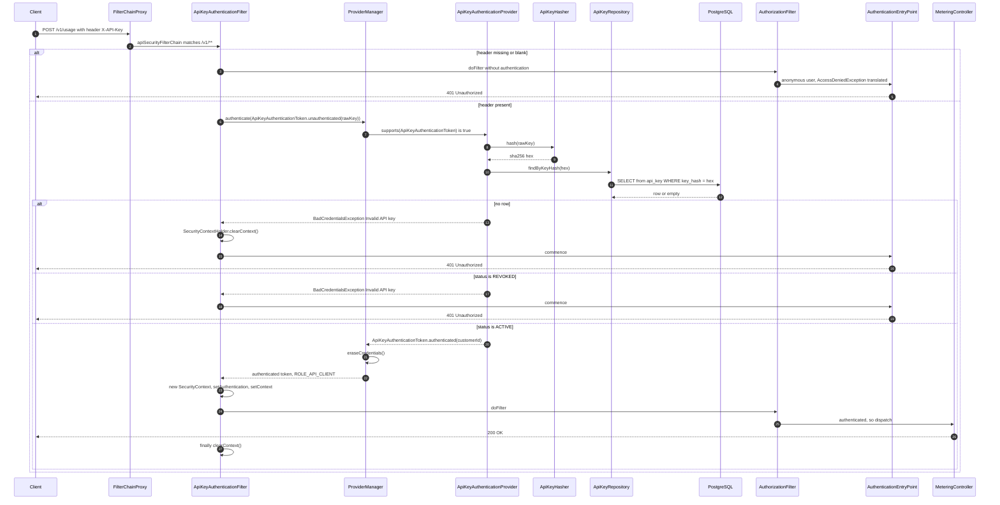
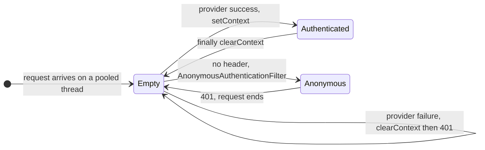

# Security

> Part of the [MeterFlow Technical Documentation](../README.md).

## Table of Contents

1. [Security Model Overview](#1-security-model-overview)
2. [API Key Design](#2-api-key-design)
3. [Authentication Flow](#3-authentication-flow)
4. [Authorization](#4-authorization)
5. [Security Context Handling](#5-security-context-handling)
6. [Control Plane Security](#6-control-plane-security)
7. [Data Protection](#7-data-protection)
8. [Threat Analysis](#8-threat-analysis)
9. [Recommendations](#9-recommendations)

---

## 1. Security Model Overview

| Plane | Paths | Mechanism | Status |
|---|---|---|---|
| Data plane | `/v1/**` | API key in the `X-API-Key` header, stateless | ✅ Implemented (M2) |
| Control plane | everything else (`/admin/**`, `/customers/**`, `/actuator/**`, `/error`) | **None.** `permitAll` | ⚠️ Temporary. **[Roadmap]** M10 adds `app_user` and admin security |

Both are configured in [`SecurityConfig`](../../src/main/java/com/meterflow/security/SecurityConfig.java).

## 2. API Key Design

| Property | Value | Why |
|---|---|---|
| Entropy | 256 bits (`SecureRandom`, 32 bytes) | Infeasible to guess or brute-force |
| Encoding | Base64URL, no padding | Safe in HTTP headers and URLs |
| Recognizable prefix | `mf_live_` | Lets secret scanners and humans identify MeterFlow keys **[Unverified: no `mf_test_` variant exists]** |
| Display prefix | First 16 characters, stored in `key_prefix` | Lets a user tell keys apart without exposing them |
| Storage | `key_hash` = SHA-256 hex, `UNIQUE` | A database leak does not reveal usable keys |
| Raw key exposure | Only in the `201` response of `POST /admin/customers/{id}/api-keys` | Cannot be retrieved again |
| Revocation | Soft: `status = REVOKED`, `revoked_at` set | Keeps history. Takes effect on the next request because there is no cache |

**Why SHA-256 without a salt, rather than bcrypt or Argon2?** Slow, salted hashes protect *low-entropy* secrets such as passwords. An API key already carries 256 bits of randomness, so precomputation and brute-force attacks are infeasible even against a fast hash. A deterministic hash also lets the key be found with a single indexed equality lookup (`WHERE key_hash = ?`) on every request. A salted slow hash would need a lookup by prefix plus an expensive comparison per request.

## 3. Authentication Flow

**Step-by-step explanation**

1. **Header extraction.** [`ApiKeyAuthenticationFilter`](../../src/main/java/com/meterflow/security/ApiKeyAuthenticationFilter.java) reads `X-API-Key`. If the header is missing or blank, the filter does **not** reject the request itself. It lets the standard Spring Security machinery decide, and because the chain requires `authenticated()`, that ends in `401`.
2. **Delegation.** The filter builds an *unauthenticated* token that carries the raw key as its credentials, and calls a **local** `ProviderManager`. That manager contains only `ApiKeyAuthenticationProvider` and is unrelated to any global `AuthenticationManager`.
3. **Verification.** [`ApiKeyAuthenticationProvider.authenticate`](../../src/main/java/com/meterflow/security/ApiKeyAuthenticationProvider.java) hashes the key, looks it up and requires `ACTIVE`. **Every** failure throws the same `BadCredentialsException("Invalid API key")`, so a caller cannot tell an unknown key from a revoked one.
4. **Token.** On success it returns [`ApiKeyAuthenticationToken.authenticated(customerId)`](../../src/main/java/com/meterflow/security/ApiKeyAuthenticationToken.java): principal = `customerId` (`Long`), authorities = `[ROLE_API_CLIENT]`, credentials = `null`. `ProviderManager` also calls `eraseCredentials()`.
5. **Context.** The filter creates a *fresh* `SecurityContext` instead of mutating a shared one, and stores it in `SecurityContextHolder` (thread-local).
6. **Failure path.** The filter clears the context, calls the entry point (`sendError(401, "Unauthorized")`) and returns **without** continuing the chain.
7. **Cleanup.** After the downstream chain completes, `finally { SecurityContextHolder.clearContext(); }` runs, so nothing leaks to the next request served by the same pooled thread. This is verified by `ApiKeySecurityIntegrationTest.shouldNotLeakAuthenticationBetweenRequests`.

### Why the filter is not a Spring bean

`ApiKeyAuthenticationFilter` is created with `new` inside `SecurityConfig`. If it were a `@Component`, Spring Boot would also register it automatically as a servlet filter for **all** URLs, outside the security chain. It would then run on control-plane requests too, and possibly twice per request.

## 4. Authorization

| Rule | Where |
|---|---|
| `/v1/**` requires an authenticated principal | `auth.anyRequest().authenticated()` in `apiSecurityFilterChain` |
| Granted authority | `ROLE_API_CLIENT`. Not checked anywhere yet (no `hasRole`, no `@PreAuthorize`) |
| Tenant isolation on the data plane | The customer identity comes **only** from the key: `CurrentCustomer.getCustomerId()`. The request body has no customer field |
| Ownership check on key revocation | `ApiKeyService.revokeApiKey` compares `apiKey.customerId` with the path `customerId` |
| Everything else | `permitAll` |

[`CurrentCustomer.getCustomerId()`](../../src/main/java/com/meterflow/security/CurrentCustomer.java) throws `IllegalStateException` (which becomes a 500) if no authenticated `Long` principal is present. That indicates a programming error, for example calling it from a controller outside `/v1/**`.

## 5. Security Context Handling

## 6. Control Plane Security

`temporaryAdminSecurityFilterChain` disables CSRF and permits every request. As a result:

- Anyone who can reach the service can create customers, plans and products, issue API keys **and receive the raw key**, revoke keys, and cancel subscriptions.
- `/customers/**` endpoints are not limited to a particular customer.

**[Roadmap]** This is intended to stay until M10 (User Identity & Admin Security). **Until then, the service must not be reachable from untrusted networks.**

## 7. Data Protection

| Data | Protection |
|---|---|
| API keys | Only the SHA-256 hash and a 16-char prefix are persisted. The raw key is returned once |
| DB credentials | `${DB_PASSWORD}` environment variable. Not committed |
| Error responses | `500`s hide internal details and return a `correlationId` |
| Transport | No TLS configuration in the app **[Unverified: expected to be terminated upstream]** |
| PII | Customer `name` only. The `email` column was dropped in `V3` |

## 8. Threat Analysis

| Threat | Current mitigation | Residual risk |
|---|---|---|
| API key guessing | 256-bit entropy | Negligible |
| API key leak from the DB | Hash only | Low |
| Key enumeration through error differences | Identical "Invalid API key" message. 404 (not 403) for revoking another customer's key | Low |
| Timing side channel on lookup | Comparison happens on the hash via a DB index, not on the raw key | Low |
| Unauthenticated admin access | None | **High** until M10 |
| Suspended customer continues using the API | None. The provider does not check customer status | Medium |
| Authentication DoS (flood of invalid keys, one DB query each) | None (no rate limiting) | Medium. **[Roadmap]** rate limiting in M7–M9 |
| Session fixation / CSRF on the data plane | Stateless, CSRF not applicable to header-based auth | Negligible |
| Thread-local context leak | `finally clearContext()` | Negligible (tested) |
| Raw key in logs | Not logged by the application. `show-sql` logs SQL with `?` placeholders, not bound values | Low |
| Inconsistent error format for 401 | — | Cosmetic (not a vulnerability) |

## 9. Recommendations

1. Check `customer.status == ACTIVE` on the data plane, either in the provider or in `MeteringService` (M3).
2. Move key verification behind `CredentialFacade` (for example `Optional<Long> authenticate(String rawKey)`), so `security` stops depending on `credential` internals.
3. Return a `ProblemDetail` body from the entry point, to keep one error contract.
4. Add per-IP or per-prefix throttling of failed authentications.
5. Until M10, restrict network access to `/admin/**` and `/customers/**`, for example with a reverse proxy.
6. If a key cache is introduced for performance, invalidate it on revocation. See [Performance](performance.md#4-caching).
