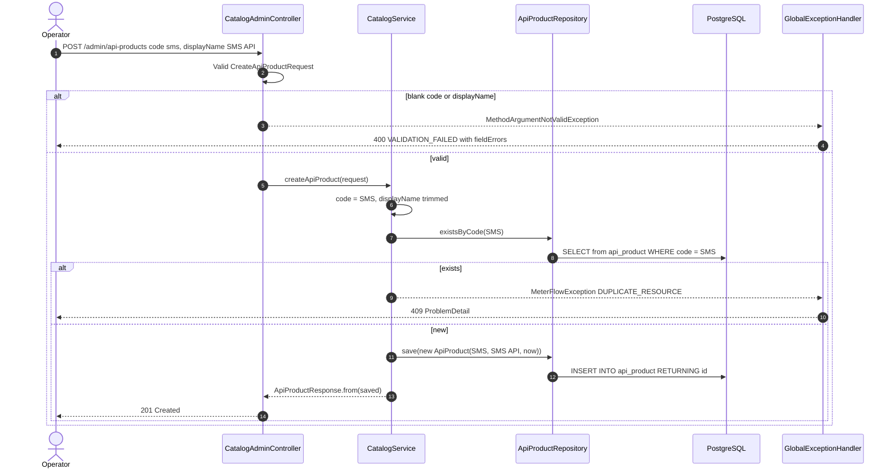
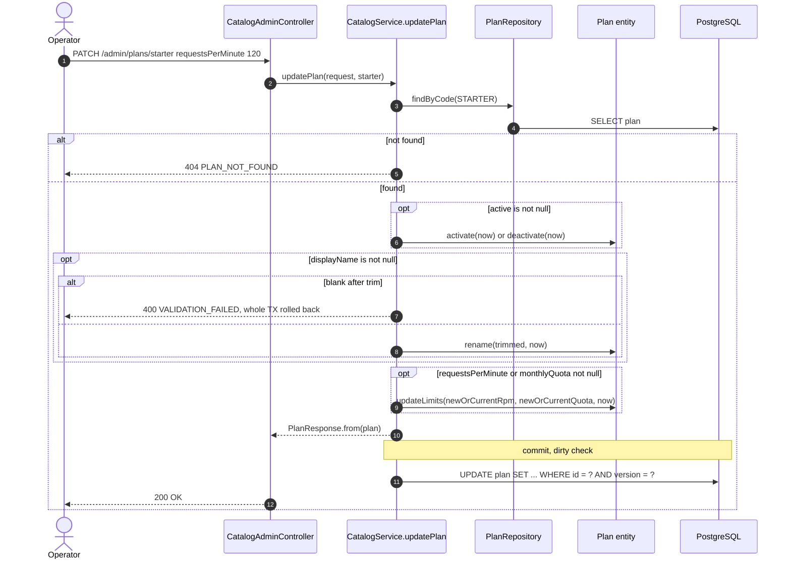
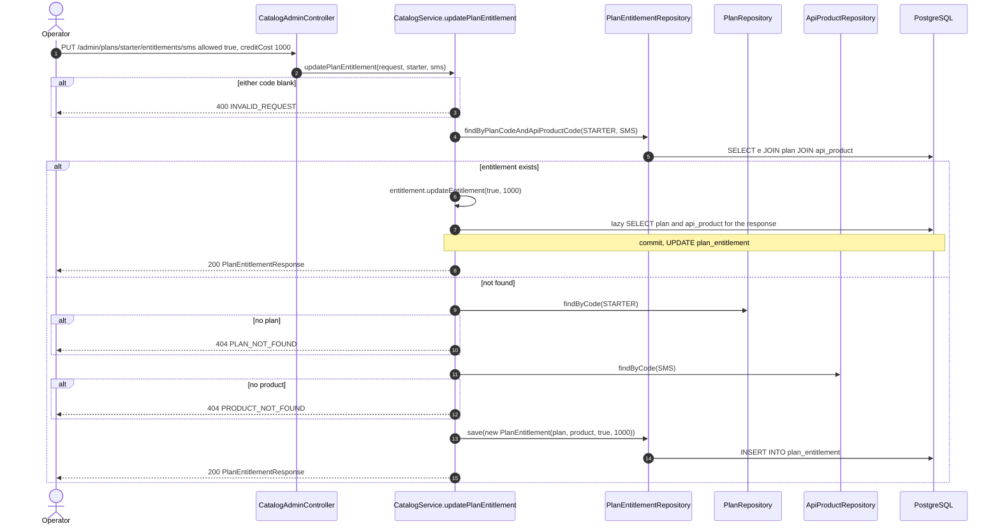
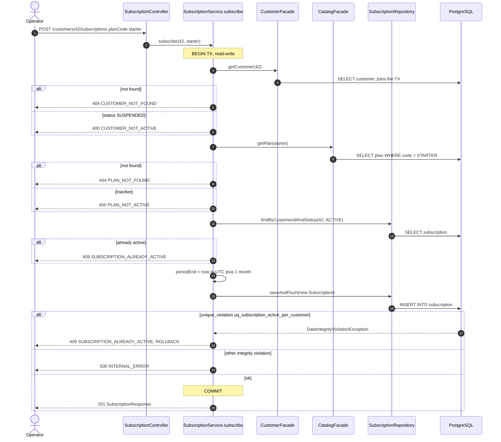
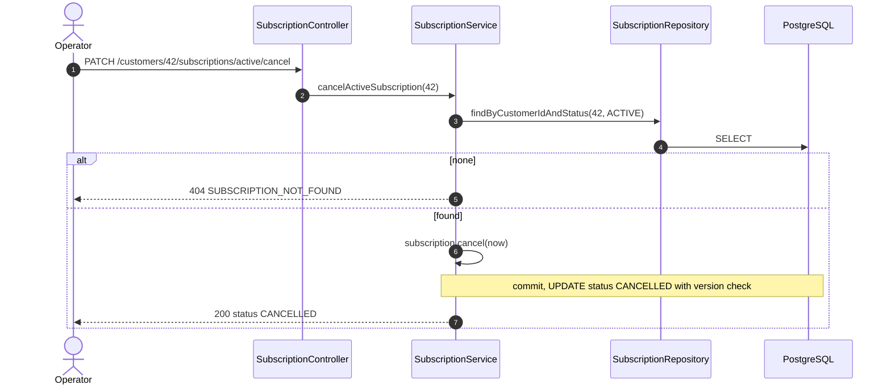
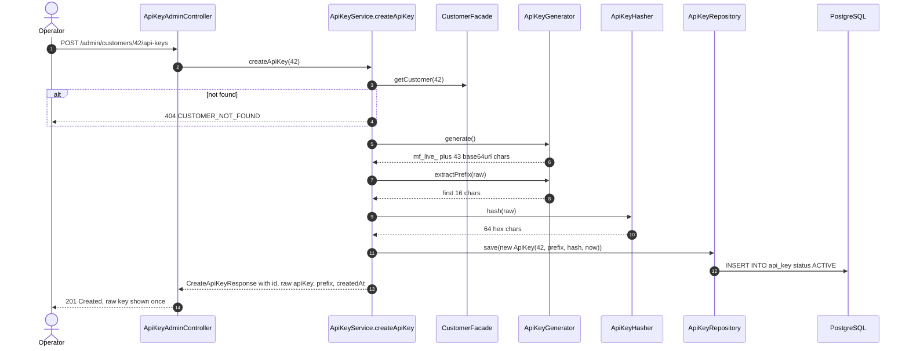
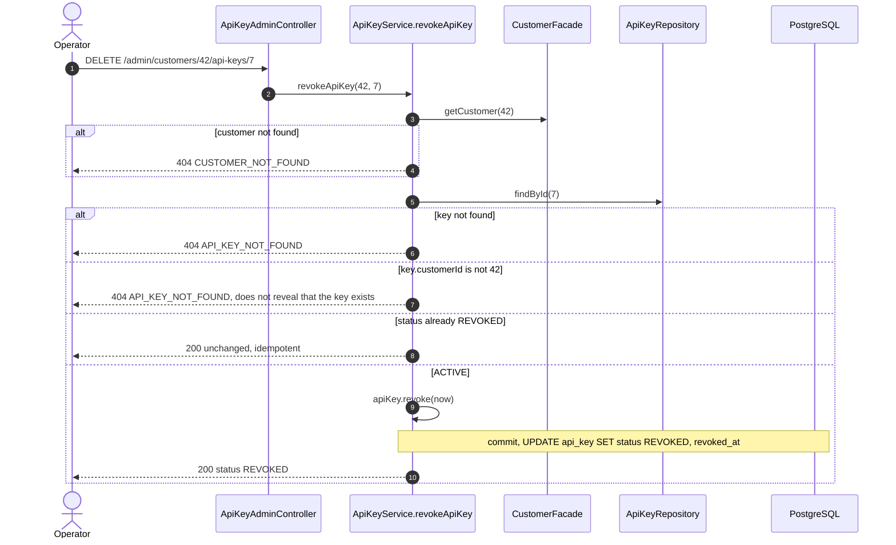
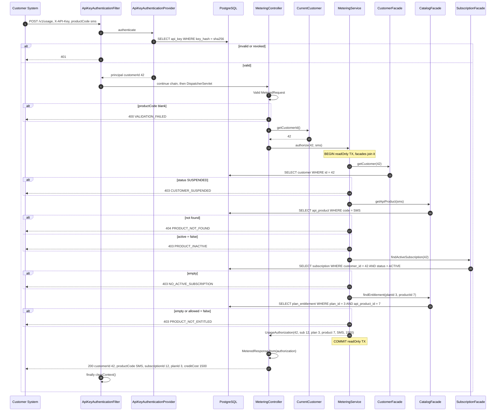

# Sequence Diagrams

> Part of the [MeterFlow Technical Documentation](../README.md). Every diagram traces real classes and methods. Error paths are shown with `alt` blocks.

## Table of Contents

1. [SD-1 Create API Product](#sd-1-create-api-product)
2. [SD-2 Partial Plan Update](#sd-2-partial-plan-update)
3. [SD-3 Upsert Plan Entitlement](#sd-3-upsert-plan-entitlement)
4. [SD-4 Subscribe Customer to Plan](#sd-4-subscribe-customer-to-plan)
5. [SD-5 Cancel Active Subscription](#sd-5-cancel-active-subscription)
6. [SD-6 Issue API Key](#sd-6-issue-api-key)
7. [SD-7 Revoke API Key](#sd-7-revoke-api-key)
8. [SD-8 Metered Usage Call](#sd-8-metered-usage-call)

Related diagrams elsewhere:

- [Request lifecycle](../technical-design/application-flow.md#1-request-lifecycle)
- [Authentication flow](../technical-design/security.md#3-authentication-flow)
- [Concurrent subscription race](../technical-design/performance.md#2-concurrency-control)
- [Database interaction](../database/database-design.md#9-database-interaction-flows)
- [Background processing](../technical-design/application-flow.md#9-background-jobs-and-asynchronous-processing)

---

## SD-1 Create API Product

**Explanation:** This shows the standard create pattern used throughout the catalog: validate, normalize, pre-check for a duplicate, insert. A concurrent duplicate that slips past `existsByCode` fails on the `UNIQUE(code)` constraint and becomes a `500`. That race is not drawn above.

## SD-2 Partial Plan Update

**Explanation:** No `save()` call is needed. The entity is managed, so Hibernate writes the changes at commit. The `@Version` predicate makes a lost update impossible. A conflicting concurrent update fails, currently with a `500`.

## SD-3 Upsert Plan Entitlement

**Explanation:** This is an idempotent `PUT`. The response must be built inside the transaction because the associations are `LAZY` and Open Session in View is disabled.

## SD-4 Subscribe Customer to Plan

**Explanation:** The facade calls join the caller's transaction (propagation `REQUIRED`). `saveAndFlush` forces the INSERT to run right away, so the database's unique-index check happens inside the `try/catch`. The concurrent case is drawn in [Performance](../technical-design/performance.md#2-concurrency-control).

## SD-5 Cancel Active Subscription

**Explanation:** Once the row is `CANCELLED`, it no longer counts toward the partial unique index, so the customer can subscribe again straight away.

## SD-6 Issue API Key

**Explanation:** The raw key exists only in memory and in this single response. The database never sees it.

## SD-7 Revoke API Key

## SD-8 Metered Usage Call

**Explanation:** This is the complete M3 data-plane path. An authorized call costs five indexed queries (one for authentication, four for authorization) and performs **no writes**. Each rejection is a `MeterFlowException` that `GlobalExceptionHandler` turns into a `ProblemDetail` with the `errorCode` shown. The arrows from `MeteringService` straight to the client are a shorthand for that path. `apiProductId` (7) travels in `UsageAuthorization` but is dropped from the HTTP response. Nothing is debited or recorded yet (**[Roadmap]** M4).
