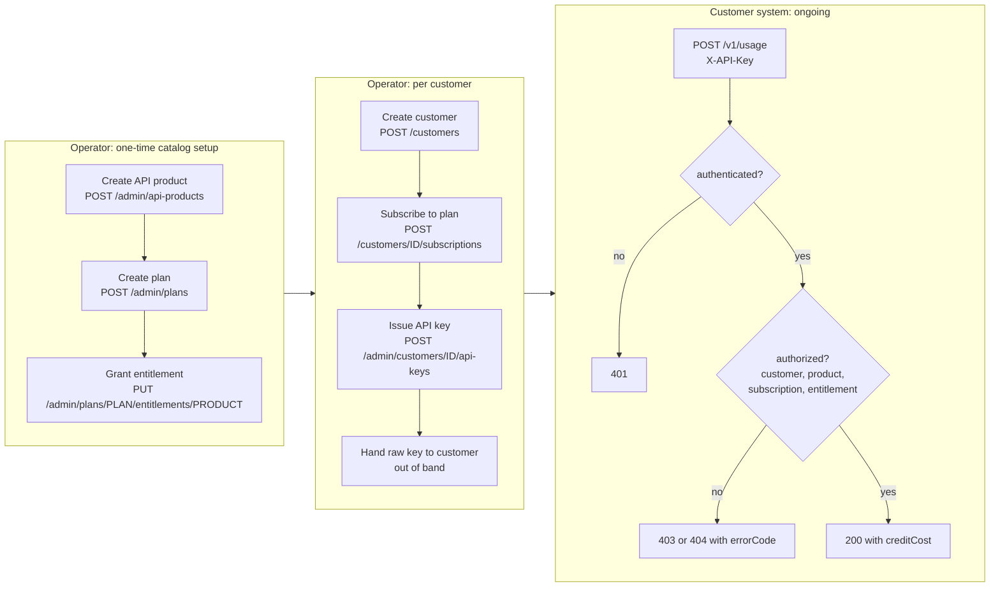
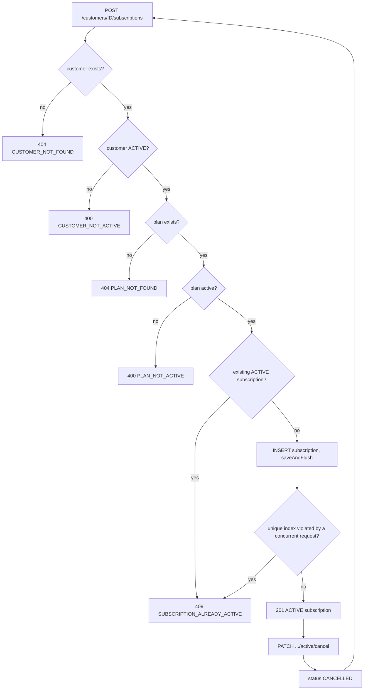
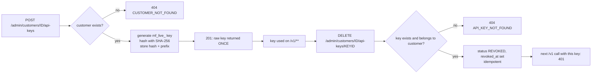
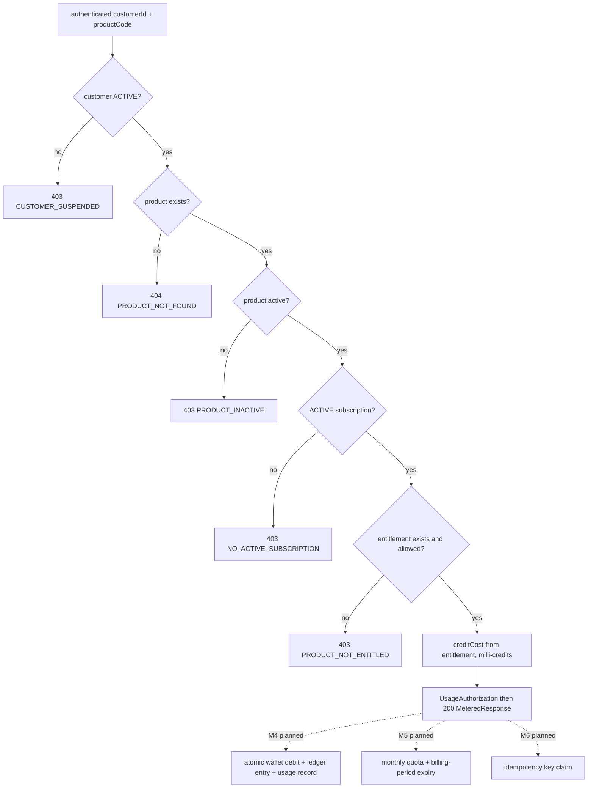

# Business Workflows

> Part of the [MeterFlow Technical Documentation](../README.md). The detailed message-level diagrams are in [Sequence Diagrams](sequence-diagrams.md).

## Table of Contents

1. [Actors](#1-actors)
2. [End-to-End Business Flow](#2-end-to-end-business-flow)
3. [WF-1 Catalog Setup](#3-wf-1-catalog-setup)
4. [WF-2 Customer Onboarding](#4-wf-2-customer-onboarding)
5. [WF-3 Subscription Lifecycle](#5-wf-3-subscription-lifecycle)
6. [WF-4 API Key Lifecycle](#6-wf-4-api-key-lifecycle)
7. [WF-5 Metered API Call (Data Plane)](#7-wf-5-metered-api-call-data-plane)
8. [Workflow Gaps](#8-workflow-gaps)

---

## 1. Actors

| Actor | Description | Interacts through |
|---|---|---|
| **Operator** | Staff who manage the catalog and customers | `/admin/**`, `/customers/**` (unauthenticated today) |
| **Customer system** | The paying customer's software, calling metered APIs | `/v1/**` with `X-API-Key` |
| **MeterFlow** | This service | — |
| **PostgreSQL** | System of record | JDBC |

## 2. End-to-End Business Flow

**Explanation:** The operator first builds the commercial catalog, then onboards each customer: create the customer, subscribe them, issue a key. After that the customer's own system calls the data plane on its own. The subscribe step and the key-issue step can run in either order, because nothing requires a subscription before a key is issued. A key without an `ACTIVE` subscription authenticates, but every `/v1/usage` call is rejected with `403 NO_ACTIVE_SUBSCRIPTION`. The plan also needs an allowed entitlement for the product (WF-1 step 3), or calls get `403 PRODUCT_NOT_ENTITLED`.

## 3. WF-1 Catalog Setup

| Step | Actor action | System behaviour | Result |
|---|---|---|---|
| 1 | `POST /admin/api-products {"code":"sms","displayName":"SMS API"}` | `CatalogService.createApiProduct`: normalizes to `SMS`, checks for duplicates, inserts with `active=true` | 201. Row in `api_product` |
| 2 | `POST /admin/plans {"code":"starter",...}` | `CatalogService.createPlan`: same pattern | 201. Row in `plan` |
| 3 | `PUT /admin/plans/starter/entitlements/sms {"allowed":true,"creditCost":1000}` | `CatalogService.updatePlanEntitlement`: inserts the row, or updates it if the pair already exists | 200. Row in `plan_entitlement` |
| 4 (optional) | `PATCH /admin/plans/STARTER {"requestsPerMinute":120}` | Partial update by dirty checking | 200 |
| 5 (optional) | `PATCH /admin/api-products/SMS {"active":false}` | Deactivate. From then on `/v1/usage` rejects the product with `403 PRODUCT_INACTIVE` | 200 |

Decision points and errors: duplicate code → 409. Unknown plan or product on the first upsert → 404. Invalid numbers → 400.

## 4. WF-2 Customer Onboarding

| Step | Action | Class.method | DB effect |
|---|---|---|---|
| 1 | `POST /customers {"name":"Acme"}` | `CustomerController.create` → `CustomerService.createCustomer` | `INSERT customer (status='ACTIVE')` |
| 2 | `POST /customers/42/subscriptions {"planCode":"STARTER"}` | `SubscriptionService.subscribe` | `INSERT subscription (ACTIVE, period = now … now+1 month)` |
| 3 | `POST /admin/customers/42/api-keys` | `ApiKeyService.createApiKey` | `INSERT api_key (hash, prefix, ACTIVE)` |
| 4 | Operator gives the raw key to the customer | — | — |

## 5. WF-3 Subscription Lifecycle

**Explanation:** Every decision point in `SubscriptionService.subscribe` maps to one `ErrorCode`. The last check (`V6`) exists only for concurrent requests and is enforced by the database. After a cancellation the customer can subscribe again, to the same plan or a different one. **There is no plan-change endpoint**: changing plans means cancel followed by subscribe. There is also no automatic expiry when `current_period_end` passes.

## 6. WF-4 API Key Lifecycle

**Key rotation**, as supported by the current API: issue a new key, switch the client over, then revoke the old key. A customer can hold several `ACTIVE` keys at once.

## 7. WF-5 Metered API Call (Data Plane)

Implemented in M3:

| Step | Component | Action | Failure |
|---|---|---|---|
| 1 | `FilterChainProxy` | Selects `apiSecurityFilterChain` for `/v1/**` | — |
| 2 | `ApiKeyAuthenticationFilter` | Reads `X-API-Key` | Missing → 401 |
| 3 | `ApiKeyAuthenticationProvider` | SHA-256, then `findByKeyHash`, then a key status check | Unknown or revoked → 401 |
| 4 | `SecurityContextHolder` | Stores `customerId` | — |
| 5 | `MeteringController.recordUsage` | `@Valid` body. `CurrentCustomer.getCustomerId()` | Blank code → 400 `VALIDATION_FAILED` |
| 6 | `MeteringService.authorize` → `CustomerFacade.getCustomer` | Customer must be `ACTIVE` | `SUSPENDED` → 403 `CUSTOMER_SUSPENDED` |
| 7 | → `CatalogFacade.getApiProduct` | Product lookup by normalized code, then `active` check | Unknown → 404 `PRODUCT_NOT_FOUND`; inactive → 403 `PRODUCT_INACTIVE` |
| 8 | → `SubscriptionFacade.findActiveSubscription` | `ACTIVE` subscription for the customer | None → 403 `NO_ACTIVE_SUBSCRIPTION` |
| 9 | → `CatalogFacade.findEntitlement(planId, productId)` | Entitlement must exist and be `allowed` | Missing or `allowed=false` → 403 `PRODUCT_NOT_ENTITLED` |
| 10 | `MeteringService` | Builds `UsageAuthorization` with `creditCost` from the entitlement | — |
| 11 | `MeteringController` | `MeteredResponse.from(...)` → 200 `{customerId, productCode, subscriptionId, planId, creditCost}` | — |
| 12 | Filter `finally` | Clears the security context | — |

Steps 6–10 run in one `@Transactional(readOnly = true)` transaction.

Not checked by design: `plan.active` (a deactivated plan keeps existing subscribers). Not checked yet: `subscription.current_period_end` (**[Roadmap]** M5).

## 8. Workflow Gaps

| Gap | Effect |
|---|---|
| No suspend or reactivate customer endpoint | `SUSPENDED` can only be set directly in the DB |
| No subscription expiry or renewal | Subscriptions remain `ACTIVE` after `current_period_end` |
| No plan change | Requires cancel + subscribe |
| No delete operations | Products, plans and customers can only be deactivated (and customers not even that) |
| No usage recording | Calls to `/v1/usage` leave no trace in the DB (**[Roadmap]** M4–M7) |
